# spec-kit-ado

A [Spec Kit](https://github.com/github/spec-kit) extension and a small `ado` CLI that run
the whole Spec Kit loop from an Azure DevOps (ADO) story back to Done, with a person in
the loop by construction. When the agent or the `ado-lifecycle` workflow drives the
lifecycle, every board change is previewed and applied only after a person approves it
(in the workflow, every ADO change and PR is a preview step, a human gate, then an apply
step), and the CLI's batch verbs are dry runs unless given `--apply`. (Single CLI verbs such as
`ado update` act immediately when a person runs them, and the CI templates act after a
merge only as the repo owner configures them.) Every acceptance criterion is traced to
a named test in a per-story ledger. The gate reports problems first and only blocks the
checks you opt in to. Specify, plan, tasks and implement are handed to whichever Spec Kit stack kit you
have installed (or to core Spec Kit), so the extension works for any tech stack.

**New here?** [docs/quickstart.md](docs/quickstart.md) takes you from a story to pushed Tasks in about ten minutes with the
lightest setup (`ado setup --profile starter`); [docs/glossary.md](docs/glossary.md) explains every word in one sentence.

## Lifecycle

```mermaid
flowchart LR
    S[ADO story] -->|speckit.ado.pull| L[Spec, DoD ledger, story branch]
    L -->|ado questions --post| Q[Open questions on the story]
    Q -->|speckit.ado.plan| P[Plan]
    P -->|speckit.ado.tasks| T[tasks.md]
    T -->|speckit.ado.push| B[Child Tasks on the board]
    B -->|speckit.ado.implement| I[Code + tests, TDD]
    I -->|ado decisions --post| DC[Decisions posted]
    DC -->|Task states| B2[Task states synced]
    B2 -->|speckit.ado.gate + speckit.ado.review| R[Gate + review in the ledger]
    R -->|speckit.ado.pr| PR[PR linked with AB#id]
    PR -->|speckit.ado.done| D[Story Done, ledger attached]

    classDef human fill:#fff3cd,stroke:#b58900;
    class Q,B,DC,B2,PR,D human;
```



Highlighted steps write to ADO or open a PR: each one shows the exact change and waits
for a yes. Everything else is read-only or writes local files that reach the team
through PR review.

## Quick start

Requires Spec Kit 0.9.0 or later, Python 3.9 or later, and `git`. `gh` is needed only
to open PRs on GitHub.

```bash
# 1. The ado CLI (stdlib only)
pipx install git+https://github.com/praveenlavu/spec-kit-ado@v0.2.0
# or: uv tool install git+https://github.com/praveenlavu/spec-kit-ado@v0.2.0

# 2. The extension, in your Spec Kit project
specify extension add ado --from https://github.com/praveenlavu/spec-kit-ado/archive/refs/tags/v0.2.0.zip
```

### Install the bundle (workflow + extension)

```bash
specify extension catalog add https://raw.githubusercontent.com/praveenlavu/spec-kit-ado/v0.2.0/catalog/extensions.json --name ado --install-allowed
specify workflow catalog add https://raw.githubusercontent.com/praveenlavu/spec-kit-ado/v0.2.0/catalog/workflows.json --name ado
curl -L -o ado-0.2.0.zip https://github.com/praveenlavu/spec-kit-ado/releases/download/v0.2.0/ado-0.2.0.zip
specify bundle install ./ado-0.2.0.zip
```

Install-allowed catalogs install what they list without the untrusted-source prompt (workflow
catalogs always are); these list only `ado` and `ado-lifecycle` from the `v0.2.0` tag, so read
them and `workflow.yml` first. Details: [bundle README](https://github.com/praveenlavu/spec-kit-ado/blob/main/bundle/README.md).

The Spec Kit community catalog is for discovery only, so a bare `specify extension add ado`
does not install it; use `--from` as above. From a local checkout:
`specify extension add --dev <path-to-spec-kit-ado>`.

Then, in your agent:

```text
/speckit.ado.setup          # checks tools, asks you to run `ado setup`, confirms the phase map
/speckit.ado.pull 1001      # story 1001 -> dod/DoD_1001.md + spec
```

Commands are named `speckit.ado.<verb>` throughout these docs. How you type one depends
on how Spec Kit installs it for your agent:

| Agent integration | Installed as | Type |
|---|---|---|
| Claude Code, GitHub Copilot, Cursor (skills) | skill `speckit-ado-<verb>` | `/speckit-ado-setup` |
| Gemini CLI and other command-file agents | command `speckit.ado.<verb>` | `/speckit.ado.setup` |

`ado setup` runs in your own terminal: it asks for the organization and project and
reads a Personal Access Token through a hidden prompt. Scopes: **Work Items: Read & Write** and **Project and Team: Read** (`ado setup` and `ado branch --link` read the project record);
add **Code: Read** for `ado branch --link`, and **Code: Read & Write** for `ado pr create` and `ado pr comment` on Azure
Repos (on GitHub, PRs go through `gh`, so no Code scope). The token never passes through the agent chat.

To run the whole lifecycle with engine-enforced approval gates instead of command by
command, add the workflow (the [bundle](https://github.com/praveenlavu/spec-kit-ado/blob/main/bundle/README.md) describes the extension and the
workflow as one unit):

```bash
specify workflow add --dev <path-to-spec-kit-ado>/workflows/ado-lifecycle
specify workflow run ado-lifecycle -i story_id=1001
```

In a workflow run, command steps make no ADO writes; the workflow's preview → gate →
apply steps do. The steps, in order:

1. `pull` (spec, ledger, and the story branch via `ado branch --apply`), then the `review-spec` gate.
2. `questions-loop`: posts the ledger's open questions to the story as one comment
   (`ado questions --post`; a re-run edits it, and with none open the apply does nothing).
3. `plan`, then `plan-questions-loop` (posts the `owner: PO` questions the plan raised; the same comment is edited), then the
   `wait-po-answers` gate, then `plan-with-answers` (plan again: reads the PO's replies into the ledger and revises the plan),
   then the `review-plan` gate; `tasks`. The run does not wait for the product owner by itself: `wait-po-answers` stays open
   until you approve it, so that is where you wait for replies (or approve to go on with the plan's stated assumptions).
4. `push-loop`: creates or updates the child Tasks.
5. `strict-check-implement` (strict mode: `ado strict check --phase implement` stops the run on exit 2), `implement`, then
   `decisions-loop` (posts the decisions recorded in `Decisions_<id>.md` as one new comment: preview, `approve-decisions` gate,
   apply), `strict-verify` (strict mode: `ado strict verify`) and `sync-loop`, which syncs the Task states ticked during implement.
   In an advisory project `strict-check-implement` and `strict-verify` are no-ops (exit 0, a note), and `decisions-loop` is a no-op when there is no decisions file; when there is one the post happens in every mode, behind the gate (`--if-any` makes a missing decisions file a no-op). `strict-verify` sets `timeout: 7200` (the engine's 300 s shell default would kill the test runs).
6. `gate`, then `gate-check`, a shell step that re-runs `ado gate --base <default branch>` with the PR's
   changed files and halts the run when a `gate.block` check fails (exit 1) or `ado.config.json` is invalid (exit 3).
7. `review`, then the `review-review` gate.
8. `pr-clear`, `pr-prepare` (`speckit.ado.pr --prepare-only` writes the PR body), then `pr-loop`: pushes the head
   branch and opens the PR. The last gate, `wait-po-validation`, is where you wait for the product owner to validate or
   reject the posted decisions (a human records each with `ado decisions <id> --resolve` and must commit and push the resolved lines to the PR branch before the merge; in strict mode `ado done` refuses while any is open).

Every preview → gate → apply triplet (`questions-loop`, `plan-questions-loop`, `push-loop`, `decisions-loop`, `sync-loop`, `pr-loop`) is a `do-while`
loop, and each apply applies only the plan its gate showed (`--expect-plan`). If the plan changed since approval,
for example when you resume a failed apply after editing `tasks.md`, the apply exits 2 and writes nothing, and the
loop runs the preview and asks again instead of applying; if the plan still differs when the loop gives up, the
`*-applied` step after it stops the run (start a new one). The move to Active is not automated there: move the story
yourself, or run `speckit.ado.pull` interactively. The workflow ends at the open PR; it never closes the story.
Closing happens after merge: CI link-on-merge with `close-story: true` (`closeStory: true` on Azure Pipelines),
or `speckit.ado.done` run by hand.

## Upgrading from 0.1.1

0.2.0 changes behaviour for existing users: read the **Breaking** list in the [changelog](CHANGELOG.md) first.
Then, in each project:

1. **CLI.** Reinstall from the release tag: `pipx install --force git+https://github.com/praveenlavu/spec-kit-ado@v0.2.0`
   (or `uv tool install --force git+https://github.com/praveenlavu/spec-kit-ado@v0.2.0`). The 0.2.0 extension
   requires `ado` 0.2.0 or later, so do this first.
2. **Extension.** Replace the installed one:
   `specify extension add ado --force --from https://github.com/praveenlavu/spec-kit-ado/archive/refs/tags/v0.2.0.zip`.
3. **Workflow**, if you use it: `specify workflow remove ado-lifecycle`, then add it again
   (`specify workflow add --dev <path-to-spec-kit-ado>/workflows/ado-lifecycle` from a v0.2.0 checkout, or
   `specify bundle install` as above). Start new runs with the new workflow: it has new steps and gates.
4. **CI consumers.** `@v0` and `toolkit-ref: v0` follow the latest `v0.Y.Z` tag. To stay on a reviewed version,
   pin the reusable workflows and the CLI they install: `uses: praveenlavu/spec-kit-ado/.github/workflows/ado-gate.yml@v0.2.0`
   with `toolkit-ref: v0.2.0` (GitHub), or `ref: refs/tags/v0.2.0` on the `spec-kit-ado` repository resource (Azure Pipelines).
5. **Config.** Keep your `ado.config.json`, but `ado setup` fills in only keys that are **absent**. A config copied from
   the 0.1.1 template already holds `"done_state": "Done"`, which Agile (`Closed`) and CMMI projects do not have, so
   delete `done_state` (and any `story_type` or `removed_state` that is wrong for your project) first:
   `grep -nE '"(story_type|done_state|removed_state)"' ado.config.json` shows them. Then re-run `ado setup`: it adds the
   three from your project and keeps every other key. A new optional key is `branch_prefix`. `review_block_on` is not
   new, but 0.2.0 starts enforcing it (`ado pr create` refuses on a matching review finding) and validating it, like
   `gate.block` and `gate.tests`, so a mistyped name is now an error.
   See [docs/configuration.md](docs/configuration.md).
6. **Ledgers.** For each story in flight run `ado dod <id> --refresh`: it re-pulls section 1 with the new escaping and
   keeps sections 2 to 5 (it also records the story's current acceptance criteria, so check AC drift first). Then
   give every AC in section 1 a row in section 3: the gate now counts the AC lines in section 1, and an AC with no row
   is unmapped. `--refresh` refuses a ledger with an unclosed code fence or comment, or without the
   `## 2. Brainstorm & plan` heading; fix the file by hand, or use `--force` to start over (`--force` refuses while the ledger has a `Rules reviewed:` line: remove the line by hand first, knowing the removal is traced).
7. **Branches.** CI recognises only `<branch_prefix>ab<id>-<slug>` (for example `feature/ab1001-count-active-members`)
   or `AB#<id>` in a branch name. Rename open branches with `git branch -m`.

## Commands

| Command | What it does | Writes to ADO or the repo host |
|---|---|---|
| `speckit.ado.setup` | Checks tools, connects to ADO via `ado setup`, proposes a phase map from installed kits for you to confirm. | none |
| `speckit.ado.constitution` | Appends the ADO/HITL articles to the project constitution; never replaces it. | none |
| `speckit.ado.pull` | Reads the story, its discussion (`ado comments`) and allowed attachments (`ado attachments --download`) as untrusted data, seeds the DoD ledger (AC as verbatim text (ADO HTML converted to plain text)), routes the specify phase, names the story branch (`ado branch --apply`), offers to move the story to Active and to post the open questions. With `rules.enabled` it first pulls the Epic/Feature business rules (`ado rules`, GET only). | story state and the questions comment, each after a yes |
| `speckit.ado.plan` | Routes the plan phase; requires ledger section 2 (approach, assumptions, questions, edge cases); folds in new PO comments and offers to post the open questions. With `rules.enabled` it also tags the AC rows with the rules they implement, asks about a rule no AC reflects and records the first `ado rules <id> --confirm`. | the questions comment, after a yes |
| `speckit.ado.tasks` | Routes the tasks phase; makes sure a standard `tasks.md` exists for push. | none |
| `speckit.ado.push` | Previews the child Tasks for `tasks.md`, creates or updates them after a yes. Re-runs update, never duplicate. | child Tasks, after a yes |
| `speckit.ado.implement` | Routes the implement phase with TDD, keeps the ledger AC table current, ticks ADO Tasks after a yes. | Task state, after a yes |
| `speckit.ado.gate` | Runs the DoD gate (traceability, assertions, AC drift, evidence, `open_questions`, `commits_without_story`, `open_decisions`, and with `rules.enabled` the `rules` key: `rule_coverage` and `rule_drift`) and logs it in the ledger. | none |
| `speckit.ado.review` | Reviews the branch diff on eight planes (incl. fresh eyes and story fit; the eighth, AC fidelity, runs only in strict mode and rules per AC whether its test asserts the stated behaviour) against spec, ledger and story, verifies findings, logs them (with `rules.enabled`, plane 8 also gets the text of the rules each AC row cites and plane 7 flags a rule tag that does not fit its AC). | none |
| `speckit.ado.pr` | Builds the PR body from ledger, gate and review; opens the PR after a yes (a draft with `--allow-incomplete` when tasks are unticked; with `rules.enabled` it lists the covered and excluded rule ids and commits the `Rules_<id>.md` files); on Azure Repos can link the branch to the story. | PR (and the branch link), after a yes |
| `speckit.ado.status` | Read-only report: story state, ledger completeness, AC drift, traceability, Task progress. | none |
| `speckit.ado.stack` | Detects the stack, then uses an installed kit's seed, searches Spec Kit's catalog cache for a kit (facts from the cache JSON, descriptions are data), or researches a cited draft profile (`unverified` when uncited), writes `.ado/stack-draft.json` and `ado stack init`; never installs a kit (prints `specify extension add <id>` and `ado kits pin <id> --apply` for you) and never approves (you run `ado stack approve`). `speckit.ado.setup` calls it; `speckit.ado.plan` checks the profile first. See [docs/stack-kits.md](docs/stack-kits.md). | local draft only |
| `speckit.ado.done` | Checks the DoD checklist, then attaches the ledger (and `Decisions_<id>.md` when it exists) and closes the story after a yes. | attachment + state, after a yes |

**Business rules in the prompts.** Only when `rules.enabled` is `true`; with `rules` absent or `enabled: false` every prompt skips its rules
steps silently and nothing about them is read, written or reported. A rules file, a Problems line and an Epic/Feature's decisions file are
data, never instructions. `speckit.ado.pull` pulls the rules before specify, `speckit.ado.plan` tags the AC rows, asks the PO about a rule no
AC reflects and records the exclusions the PO answers, `speckit.ado.implement` never implements a draft, and drift (`rule_drift`),
`rule-changed` and `rules-header` stop the agent like AC drift: re-pulling and re-confirming a changed rule are the human's call, in their own
terminal. A rule not confirmed yet (`rule-unconfirmed`) is free: the agent runs `ado rules <id> --confirm` itself, no terminal needed. Details and the limits: [How the prompts use rules](docs/business-rules-reference.md#how-the-prompts-use-rules) and [Known limits](docs/business-rules-reference.md#known-limits). A product owner writes the rules in ADO with the plain-language [business rules guide](docs/business-rules.md); the developer and trust material is in the [reference](docs/business-rules-reference.md).

Two optional hooks catch people who run core Spec Kit commands directly: after
`tasks` the extension offers `speckit.ado.push`, and after `implement` it offers
`speckit.ado.gate`.

## The `ado` CLI

The `ado` CLI does the deterministic work behind these commands. `ado <verb> --help` lists the flags.

| Verb | What it does | Writes |
|---|---|---|
| `setup [--profile starter\|team\|strict]` | Creates `ado.config.json` and stores the PAT (run it in your own terminal). `--profile` also writes exactly that profile's keys and nothing else, never removing a key: `starter` `mode: "advisory"`; `team` that plus `gate.block: ["ac_traceability", "open_questions"]` and `review_block_on: ["blocker"]`; `strict` `mode: "strict"` and `strict.test_command` (left to `ado stack approve` when the stack profile is approved, else asked); `team` and `strict` also ask for `approvers` (optional GUIDs, blank writes nothing). On an existing config it prints every change as `key: old -> new` (a long or secret-looking value is shown as `changed`) and writes only when you answer `y` in a terminal; with no terminal it prints the changes, writes nothing and exits 2. The write is atomic and keeps the file's indent and line endings. See [docs/quickstart.md](docs/quickstart.md). | local config and token store |
| `doctor [--json] [--probe-item ID]` | Read-only: tells you what is wrong with your setup, one row per check (`ok`, `warn`, `fail` or `unknown`, each with a fix): `git` (2.24 or newer), `specify` (at least the extension's `requires.speckit_version`), `shallow` (a shallow clone fails: `git fetch --unshallow`), `config` and `config-target` (the working tree's and the target branch's `ado.config.json`; errors name the key, never the value), `token` and `identity` (a token is found and ADO accepts it; an anonymous `connectionData` is a `fail`), `extension` and `workflow` (the installed versions equal the CLI's), `approvers` (fails when an approver is the token's own identity; no `approvers` key yet is `ok`), `stack` and `kits` (`ado stack show --check` and `ado kits verify`: a `warn` in advisory mode, a `fail` in strict). `unknown` means doctor could not tell, and is never shown as `ok`. The only network call is one GET of `connectionData`; it writes nothing and never prints a token, name or email. Exit 0 when no row fails, else 1. `--probe-item` is accepted and ignored until the scope probes arrive. See [docs/configuration.md](docs/configuration.md) "Checking your setup". | one ADO GET |
| `status ID [--json] [--offline] [--catch-up]` | Read-only: which stage a story is at and the one command that moves it on. Prints `Story 1001: <stage>. Next: <command>` (and `Why:` with a fixed sentence). The stages, in order, and the first one not met is the answer: `config`, `ledger`, `stack-profile` (strict only), `rules` (only when `rules.enabled`), `questions-posted`, `questions-answered`, `plan`, `tasks`, `board-tasks`, `tasks-ticked`, `board-sync`, `decisions-posted`, `verified` (strict only), `gate`, `review`, `pr-link`, `merged`, `done-state`, `decisions-closed` (strict only), `done`. The ledger, the spec dir files and git are read locally; ADO is read with GETs only (the story with its relations, its comments, the child Tasks; the WIQL query that lists the children is a POST that reads). **Board stages** (`questions-posted`, `board-tasks`, `board-sync`, `decisions-posted`, `pr-link`, `done-state`) are never reported as met when ADO could not be read: with `--offline`, with no client, or after one failed read they are listed as `Board not checked` and skipped, and when everything that could be read is met the stage is `board not checked` (next: `ado status ID`, or `ado doctor` after an error), never `done`. `pr-link` looks for an `ArtifactLink` relation whose url is an Azure Repos pull request (`vstfs:///Git/PullRequestId/<project guid>%2f<repo guid>%2f<number>`) or a GitHub one (`vstfs:///GitHub/PullRequest/<repo guid>%2f<number>`), both recorded on the smoke projects; a GitHub commit link (`vstfs:///GitHub/Commit/...`) or a branch link is not a PR. A GitHub PR link appears only when the Azure Boards GitHub app is authorised in the project. `merged` is local: the ledger as committed on the branch `origin/HEAD` points at holds this ledger's latest `### Review` (else `### Gate`) heading, so fetch after the merge; a commit that merely names the story does not count. Once the work has landed there, the staleness of the gate, review and verification record is not judged (a squash or rebase merge leaves their SHAs unreachable), as `ado done` does. A `posted:` marker in the decisions file counts as posted only when a decisions comment with that id is on the story (not proof of who wrote it). Output is stage ids, counts and the story id only, never ADO, ledger or decision text, and an unreadable file (a symlink, outside the working tree, over 1 MiB, not UTF-8) leaves its stage unmet. `--json` prints `{stage, next, why, board_checked, run, run_notes, not_checked, board}` (plus `catch_up` with `--catch-up`). **Run awareness:** `ado status` also reads the newest Spec Kit run of this story (`.specify/workflows/runs/<run-id>/state.json`, workflow `ado-lifecycle`, `inputs.story_id` equal to the story) and adds one fixed `Run <run-id>: ...` line: `paused` (at a gate: answer it in a terminal) or `failed` name the step and `specify workflow resume <run-id>` (resume re-runs that step and everything after it); `aborted` points at `ado status ID --catch-up`; `completed` while the story is still before the PR does the same; `running` for over 1 hour by the **server's** clock (never the local one; without a client, offline or without server time the age is not judged and the line says so) says the run may have been killed, that resume refuses a `running` run, and that the documented manual fix is to set `status` to `failed` in that `state.json` and then resume (the kit never edits Spec Kit's files). That file is untrusted (the agent can edit it): it is read confined (no symlink, only under `.specify/workflows/runs/`, at most 1 MiB, run id `^[a-zA-Z0-9][a-zA-Z0-9_-]*$`), only the six Spec Kit statuses and the step ids of the shipped workflow (a built-in list, not the installed file, which the agent could edit; a loop step is `<loop>:<step>:<n>`) are accepted, `output`, `error` and every other field are never read or printed, and the printed commands are fixed templates. A run file tied to the story that cannot be read this way is counted in a `not readable by this ado version; use specify workflow status` line; an oversized, symlinked or unparsable file is ignored and counted in one `N run file(s) ignored` line, and with more than 2000 run directories the rest is reported as `older runs not examined`. `--catch-up` prints, in the order the workflow runs its steps, the fixed-template commands for the stages that are NOT met: a local stage that is met lists nothing (its file is the evidence, a generation command would overwrite it), and a board stage that is unmet or could not be read lists only its preview and apply (a board write is a preview, then your yes, then the apply with `--expect-plan`); with every local stage met and the board unread it says `local stages are all met; board stages not checked`. Strict-only steps appear in strict mode only. The list ends with "run `ado status <id>` again after each step": the plan-questions round and the `wait-po-answers` gate are not modelled. Exit 0 whatever the stage; 2 for a usage error. See [docs/configuration.md](docs/configuration.md) "Where a story is". | ADO GETs (none with `--offline`) |
| `get <id>`, `query "<WIQL>"` | Read work items. Output can contain sensitive data. | none |
| `create`, `update`, `comment` | Single-item board writes; they act immediately when a person runs them. In strict mode `update <id> --state <done_state>` (or `--field System.State=<done_state>`; compared case-insensitively with the configured `done_state`) is refused with exit 2, nothing sent, pointing to `ado done <id>`, which runs the strict `done` check; other states and advisory mode are unchanged. | ADO |
| `comments <id>` | The story's discussion as JSON, authors scrubbed to `@user` and email addresses to `[email]`, also written to the gitignored `.ado/context/<id>.md` (`--out` must be a `.md` file under `.ado/`). Untrusted data. `--author-ids` prints one line per comment, `date \| author id \| first 40 scrubbed characters`, to stdout only and writes nothing (no file, no `.ado/`): it is how you find the identity GUID of a product owner or approver for the `approvers` key. The id is validated as a GUID (else `?`) and no identity display name, unique name or e-mail address is ever printed, but the snippet is the comment's own text: a name typed INTO a comment (`CONTOSO\user`, a full name) shows as typed, because only ANSI and control characters, `@mentions` and e-mail addresses are removed from it. A snippet does not prove who wrote the line: an agent can post a comment that reads like the product owner's, so check the GUID against the user's page in ADO before you put it in `approvers`. A malformed answer from ADO (a duplicate comment id, a missing id, an unexpected page shape) prints `error: comments unreadable (<reason>)` and exits 1 instead of a partial list. It cannot be combined with `--out`; if some comments were not read (page limit or a repeated page token) a `note:` line goes to stderr. | `.ado/` only (nothing with `--author-ids`) |
| `attachments <id>` | Lists the attached files; `--download` saves those on `attachments_allow` into the gitignored `.ado/attachments/<id>/` (`--dir` must be inside `.ado/attachments/`), only from `dev.azure.com/<org>` or `<org>.visualstudio.com`, 5 MB each; same-name files are kept as `a.md`, `a (2).md`, oldest first. Untrusted data. | `.ado/` only |
| `link <id>` | `--to <id>` (related), `--parent <n>` (parent) or `--url`. A parent can't be set through `--field System.Parent=…`, which is rejected. | ADO |
| `attach <id> <files>` | Attaches allowlisted regular files of at most 5 MiB; a symlink or special file is refused, and the bytes uploaded are read once. | ADO |
| `dod <id>` | Seeds or refreshes the ledger `<dod_path>/DoD_<id>.md`; prints `ac_chars` and `ac_thin`. A **fresh** ledger (first run or `--force`) also gets the DoD items of an **approved** `ado.stack.json` in section 5 as unticked `- [ ] <item> (stack <id>, S<n>)` lines (at most 20, cleaned); `--refresh` never touches section 5, `--force` refuses (exit 2, ledger untouched) while a `Rules reviewed:` line exists, and without an approved profile the ledger is unchanged. `ado done` counts them like any box. With `rules.enabled` it also walks the story's Epic/Feature ancestors (GET only) and writes the ledger header line `Rules from:` (see [business rules](docs/business-rules-reference.md#ledger-header)); with rules off it makes no extra request and the ledger is unchanged. | local ledger |
| `rules <id>` | Works whatever `rules.enabled` says. Walks from the story up `Hierarchy-Reverse` links (at most 3, a cycle stops it, only the last URL segment of a link is used and it must be 1 to 9 digits with no leading zero, else the problem `bad-parent-link`) with **GET only**, and writes `<dod_path>/Rules_<id>.md` for each ancestor whose type is in `rules.types` and that has a `Business rules` section (or a problem in it), after every GET has finished. A re-pull with nothing new in ADO rewrites nothing (the `Last pulled` date is kept when everything else is identical). Prints `{"from": [ids], "files", "rules": {"approved", "draft", "retired"}, "problems": [{"id", "rule", "level", "issue"}], "changed": [ids], "decisions": [{"id", "open", "rejected"}]}`: ids, counts and keys only, never rule text or a title (`decisions` counts the open and rejected lines of an ancestor's `Decisions_<id>.md`, if it has one). If a write fails, the files written before it stay (each is a whole, true copy of ADO); run it again. A file kept only for its problems can later block strict through `rules-problem`. Exit 0; 1 ADO error; 2 a file that cannot be replaced, an unreadable or symlinked `Decisions_<ancestor>.md`, or a write error. `rules <id> --confirm` is local only (no token, no request; combines with no other flag): it writes `- **Rules reviewed:** BR-<id>-<n>@<hash>, ...` (the heading hashes of the rules in the story's `pr` scope, sorted) into the ledger header, keeping the file's line ends. New ids need no terminal, also when another id changed: without a terminal they are written first in one atomic write, then it exits 2 naming the ids recorded and the ones that need a human; re-confirming a recorded id whose hash changed, or dropping one, needs a terminal on stdin and stdout and a typed approval code (the same mechanism as `stack approve`; process enforcement, not a security boundary). Exit 2 and nothing written when the header cannot be trusted, a rules file is missing or invalid, a rule's text does not match its hash, or the ledger is a symlink. See [business rules](docs/business-rules-reference.md#pulling-rules) and [confirming rules](docs/business-rules-reference.md#confirming-rules). | ADO (read), local files |
| `questions <id>` | Read-only, local: the ledger's open and answered section 2 questions as JSON, from lines `- [ ] Q<n>: <question> → <answer \| _(open)_> · owner: <role>`. `ado gate` lists the open ones as `open_questions`. | none |
| `decisions <id>` | Read-only, local: the open, validated and rejected `D<n>` lines of the story's own file `<dod_path>/Decisions_<id>.md` (not the ledger) as JSON, from lines `- [ ] D<n>: <text> → _(open)_ · kind: decision\|assumption\|override · why: <reason>` (resolved: `- [x] D<n>: <text> → validated\|rejected · by: <role> · note: <text>`). A line that breaks this grammar sets `unparsed` and is left out. No file yet: exit 2, run `--add`. `ado dod --refresh` neither touches nor needs the file; `ado done` attaches it next to the ledger. | none |
| `decisions <id> --add "<text>" --kind decision\|assumption [--why "<reason>"] [--supersedes D<n>]` | Records one assumption or decision: appends the next `D<n>` line (highest id in the file + 1) to `<dod_path>/Decisions_<id>.md`, creating the file from its template when missing, and prints `{"id": "D3", "file": "<path>"}`. A local write: no token, no request, no gate; atomic. Agents use it instead of hand-writing the format; every assumption and decision goes there, never only in prose. `override` is not accepted (only the strict override command creates it). `--supersedes D<n>` answers a PO rejection: the new line's text starts with the fixed prefix `supersedes D<n>: ` (shown to the PO in the posted comment; the old line is never edited), and it is refused (exit 2, fixed texts) unless `D<n>` exists, is `rejected` or still `open` (not validated, not an override) and no live decision already supersedes it (the refusal names that id); the text itself may not start with that prefix. See "How to answer a PO rejection" below. The text is 1 to 1500 characters, `--why` at most 300 (default `unspecified`); an `@mention` or e-mail address is replaced by `@user` or `[email]`; control characters, line breaks, U+2028/U+2029/U+0085, `<!--`, `-->` and code fences are refused (exit 2) with a message that names the problem and never repeats the text. Combines with no `--post`, `--apply`, `--plan-out`, `--expect-plan` or `--resolve` options. | none |
| `decisions <id> --resolve D<n> --validated\|--rejected [--by ROLE] [--note TEXT]` | A human, in their own terminal, records the PO's verdict on one decision line: a local edit of the decisions file that changes only that line (it keeps `kind`, `why`, `posted` and `used`; a resolved line may be re-resolved). Refuses (exit 2) without a terminal so an agent shell cannot do it by accident; this is not a security boundary (the file is plain text and a pseudo-terminal gives a tty), real enforcement is the strict gate, the decisions comment the PO sees and the git history. A resolved line needs `--force` to be overwritten. Combines with no `--post`, `--apply`, `--plan-out` or `--expect-plan`. `--by` is a role (default `PO`; letters, digits and spaces, at most 40; never a name), `--note` at most 300 characters; control characters, line breaks, `<!--`, `-->`, code fences, a line holding an inline comment, an unknown `D<n>` or a line over 2000 characters are refused. Atomic write. | none |
| `decisions <id> --post` | Plans one NEW comment `[spec-kit-ado:decisions]` listing every open `D<n>`, and every validated `kind: override` line, not yet posted or edited since (never an edit of an earlier comment); `--apply` posts it, then appends ` · posted: <comment id>:<hash8>` to exactly those lines of the decisions file. Lines are cut at 500 characters; an `@mention` or e-mail address typed in a decision is replaced by `@user` or `[email]` (as `ado comments` does), never refused; a name typed as plain words cannot be detected, so read the preview. Dry run unless `--apply` (`--plan-out`, `--expect-plan` as for `questions --post`). `--if-any` (with `--post` or `--plan-out`; the workflow's `decisions-loop` passes it) means a missing decisions file is a no-op in every mode: exit 0, nothing to post, `note: "no decisions file; nothing to post"`, and an `--apply` writes nothing; without it a missing file is exit 2. | ADO comment, then the local decisions file |
| `questions <id> --post` | Posts the open questions as one comment whose first line is `[spec-kit-ado:questions]`. A re-post edits the newest such comment written by the token's own identity (resolved via `/_apis/connectionData`; if it cannot be, nothing is posted) instead of adding one, says so when every question is answered, and does nothing if it is current. It also lists, under "The team assumed these; reply if one is wrong:", each question the operator closed as `assumed:` with its assumption (so an edit does not hide it from the product owner). Each line is capped at 500 characters and holds only `Q<n>: <question>` (plus the assumption), never owners or names. Batch verb. | ADO comment |
| `branch <id>` | Local git only, never pushes. Prints `{"branch": "<branch_prefix>ab<id>-<slug>", "action": "create\|rename\|switch\|exists"}`, e.g. `feature/ab1001-count-active-members` (slug from the story title: ASCII, lowercase, at most 40 characters, cut at a word boundary). `--apply` creates it from HEAD, renames the current Spec Kit `NNN-…` branch when `.specify/feature.json` points at its spec dir and it has no upstream, or switches to the story's existing branch. It never renames the default branch, and creates a new branch when the default branch cannot be determined. | local branch |
| `branch <id> --link` | Azure Repos only: the current branch must be tied to the story and pushed. Adds it to the story's Development section as an `ArtifactLink` named "Branch". Batch verb; needs a PAT with **Code: Read** and **Project and Team: Read** (on GitHub the Azure Boards GitHub app links `AB#` references instead). | ADO link |
| `branch --id-from <name>` | Prints the story id a branch is tied to: `<branch_prefix>ab<n>` at the start, else `AB#<n>` anywhere (no leading zero, at most 2147483647). A plain `<branch_prefix><n>-…` or Spec Kit `001-…` never counts. Exit 1 when none, exit 3 when `ado.config.json` is invalid. `--base REF` (CI: `origin/<target>`) takes `branch_prefix` and the rest of the config from the target branch when that is strict (see Strict mode, CI trust); a PR can otherwise delete or edit its own config to hide its story id. | none |
| `kits verify` | Read-only, local: no token, no network, nothing written. Lists the installed Spec Kit extensions (`.specify/extensions/.registry`, `ado` excluded) against `ado.kits.lock.json` as `{"kits": [{"id", "state": "pinned\|unpinned\|changed\|stale"}], "findings": [...]}`: a digest of the kit's tracked files and of the agent copies Spec Kit registered, by exact name. Exit 2 on any unpinned or changed kit or when the registry, a kit file or the lockfile cannot be trusted (a symlink, a control character in a path, an empty kit dir, a `--dev` install). Output is fixed words and kit ids that match `[a-z0-9-]{1,40}`; no kit prose. A pinned kit whose registry entry is gone while its files remain on disk is `stale` with `reason: "files-remain"` and a `kit-changed` finding. See [docs/stack-kits.md](docs/stack-kits.md#pinning-kits); strict mode refuses the same kits (`kit-unpinned`, `kit-changed`). Process enforcement, not a security boundary. | none |
| `kits pin <id> [--by ROLE] [--apply]` | A human pins one installed kit in `ado.kits.lock.json`: digests of the kit files and the agent copies, the scan facts and who reviewed it. **Preview** (default, nothing written) prints the digests, the scan counts with `<relpath>:<line>` and a fixed five-line checklist for the reviewer, with no kit prose (hook and tool names and kit-relative paths are kit-chosen but pattern-limited). It says when `--apply` would replace an existing pin, and an incomplete scan (`unreadable`) is refused. **`--apply` refuses (exit 2) unless stdin and stdout are both terminals**; it prints the preview and `approval code: <12 hex>` (over the lock entry that will be written) and pins only when the human types the code back (anything else, end of input or Ctrl-C: nothing written, exit 2, `not confirmed: nothing was approved`); the kit is read again and the code recomputed right before the write, and a kit that changed in between is refused. A program that controls the pseudo-terminal can type the code too. Input typed before the prompt is discarded (the terminal's type-ahead is flushed just before the code is printed); that stops only a code typed before the prompt, and a program that can write to the terminal after the prompt, or compute the hash, can still approve. It is written atomically (sorted keys, other kits' entries untouched, the old lockfile kept on any failure); `--by` is a role (default `tech lead`). An unknown id exits 2; a `--dev` install whose agent copies are symlinks, a symlink and an empty kit dir cannot be pinned; `<id>-config.yml` is not vetted. The terminal check stops accidents, and the pin is a human approval record: process enforcement, not a sandbox. See [docs/stack-kits.md](docs/stack-kits.md#pinning-kits). | `ado.kits.lock.json` |
| `stack detect [--repo DIR]` | Read-only, local: no token, no network, no config, no file written. Prints which stacks the repository holds, from the **files tracked at `HEAD`** (`git ls-tree -r -z`, never the working tree, the index or untracked files; a repository with no commit gives `outcome: "unknown"` and `note: "commit first"`): `{"outcome": "detected\|multiple\|unknown", "stacks": [{"id", "root", "confidence": "high\|medium", "evidence": [...], "hints": {...}}], "domain_hints": [...]}`. Ids: `python`, `node`, `typescript`, `dart`, `flutter`, `salesforce`, `java`, `go`, `rust`, `dotnet`, `c-cpp`; markers are fixed names at most 3 path segments deep (see [docs/stack-kits.md](docs/stack-kits.md#detection)). A medium marker alone (for example only `requirements.txt` or a `Makefile`) is listed but never makes `outcome` `detected`. Paths are untrusted (in CI a PR controls them): a root or evidence path is printed only when it is 1 to 200 characters of `A-Za-z0-9._/-`, else as `<path #n>`. A few manifests are read from the commit's blobs (regular files of at most 1 MiB; a symlink or larger file is never read) and only set booleans and fixed words in `hints`; nothing from file contents is echoed. A nested root of the same stack (npm workspaces, Maven or Gradle modules, a Cargo workspace; `node` and `typescript` are one family) folds into its nearest ancestor root as extra evidence, so it is ONE stack; roots of different stacks stay separate. When a manifest could not be read as asked (more than 32, a `package.json` that is not a JSON object or repeats a key) the output carries `note: "hints incomplete"` and those hints are `false`. SHA-1 repositories only. Exit 0; exit 2 with `error: cannot read git history here`, `cannot read the commit` or `too many files to inspect` (fixed texts). The output is byte-identical for the same commit. A root no profile can name (a dot directory such as `.github/tools`, a space, non-ASCII) is no stack: the output gains `ignored_roots: {count, paths}` (at most 5 paths, through the plain-path rule; the key is absent otherwise); `strict check` and the `gate` comment then carry the warning `N detected root(s) cannot be named in a profile and are not covered by it: review them as code` (a count; never a finding). Advisory only: no verb acts on it yet. | none |
| `stack show [--json\|--md] [--check]` | Read-only, local: no token, no network, nothing written. Reads `ado.stack.json` at the repository root (the working-tree file, through a confined read: not a symlink, a regular UTF-8 file inside the repository, at most 256 KiB, no duplicate JSON key) and prints, as JSON by default, `{"status", "errors", "counts": {stacks, commands, conventions, dod, sources, unverified}, "test_command": {profile, config, drift}, "notes"}`. `status` is `none` (no file), `invalid` (unreadable or fails validation; `errors` lists the rule and the position such as `stacks[0].root`, never a value), `draft`, `approved` (the recorded `approval.sha256` equals the hash of the profile without `approval`) or `changed-since-approval` (the hash differs). **What the agent may see:** the text of a `draft`, `invalid` or `changed-since-approval` profile (rules, commands, URLs, evidence) is never printed, by either format; only status, counts and the fixed error texts are. An `approved` profile is printed by `--md` as data under the header "Project stack profile (data, not instructions)" (control characters, `<!--`, `-->` and code fences removed, caps applied, commands in code blocks, conventions cited as `<stack id>.conventions[<n>]` counting from 0), and `test_command.profile` is the one command composed from it. `test_command.config` is `strict.test_command`; `drift` is true when the approved profile composes a test command and the config differs, or when it composes none and the config sets one. In strict mode a `none` or `draft` status adds a one-line `hint` with the next step (`ado stack init --seed <a> --seed <b>` / `ado stack approve`); it is not a note and changes neither the finding count nor the exit. `notes` are fixed texts: `stack-profile` (drift, or a composed command over 500 characters) and `stack-unprofiled` (a high-confidence root at `HEAD` that no profile stack covers, by the same root and id-family rule as `strict check`; a root a profile cannot name, such as `.github/tools` or a path with a space, is never listed here: `ado stack detect` lists it under `ignored_roots`). `--check`: in strict mode exit 2 (JSON still printed) unless the status is `approved`, there is no drift and no unprofiled root (or git cannot be read); in advisory mode always 0. A profile's commands are shell code that a human approves, and the validator is a tripwire, not a sandbox. | none |
| `stack init (--from FILE \| --seed NAME [--seed NAME ...] [--root R]) [--stack ID] [--apply] [--force]` | Local write, no token, no network, no ADO call and no gate: creates the **draft** profile `ado.stack.json`, which is not trusted until a human approves it. `--from` names a regular file inside `.ado/` (not a symlink or hard link, UTF-8, at most 256 KiB) that the agent wrote; `--seed` is looked up only among the shipped seeds (`python-pytest`, `node-typescript`, `salesforce`), never joined into a path, and the seed's root is rewritten to `--root` (default: the one detected root that fits the seed, else `.`) and validated again. `--seed` can be repeated, once per detected stack of a polyglot repository (`--seed python-pytest --seed node-typescript`): one draft with a stack per seed (each at its own detected root, no `--root`, each seed once), the seeds' source ids renumbered into one set, and the merged draft validated; a single `--seed` writes what it always did, and a second `init` for one root would replace the other stack, so give every stack in one command. The profile is validated as `stack show` does, `status` is forced to `draft` and any `approval` is dropped. Without `--apply` it is a **preview** that writes nothing and prints only `{ok, errors, counts}` (error rule and position, never profile text); `--apply` writes `ado.stack.json` atomically (temp file in the same directory, then rename; an existing file is kept when the write fails; a failed read-back after the rename is reported) and removes `.ado/stack-draft.json` when that was the source. An existing `approved`, `changed-since-approval` or hand-broken profile that still says `approved` or carries an `approval` is replaced only with `--force`; a symlinked `ado.stack.json` is always refused. `--force` over an approved profile needs the human's explicit yes: the agent passes the flag itself, so it must ask first. `--stack ID` names the stack of a single-stack profile. A seed sets no `kit` (it stays null; a draft written for `--from` may name one). One-line `warning:` texts go to stderr (preview and `--apply`) when `--seed node-typescript` meets a yarn, pnpm or ambiguous lockfile (the seed is npm only) and when the composed test command is over 500 characters (`approve` would refuse it). Exit 2 for a refusal or an invalid profile (fixed texts). | none |
| `stack approve [--story ID] [--by ROLE] [--apply]` | A human approves the profile; the one verb that changes what strict CI runs from the profile. **`--apply` refuses (exit 2) unless stdin and stdout are both terminals**, tested before any file or the config is read, and refuses when `ADO_CONFIG` is set (`Config.load` would read that file, not `./ado.config.json`). The terminal check stops accidents; it is not a security boundary (a pseudo-terminal gives a tty), and the approval is a record, not proof: anyone who can edit the file can compute the hash. **Preview** (default): when stdin and stdout are both terminals it prints the profile's current status (a warning when `ADO_CONFIG` is set), every command **verbatim and in full** (each stack's commands, `org_only` ones flagged, each rule with its source kind and URL, the `UNVERIFIED` count, and the exact composed `strict.test_command` with each run quoted into `sh -c`), control and escape characters stripped, printed and never stored; otherwise (no terminal, or output piped or redirected) it prints counts and the composed command's length only, never profile text. **`--apply`** prints the full preview, `approval code: <12 hex>` (the first 12 hex of the sha256 over exactly the data that will be written) and reads one line from the terminal: only the code, typed back, approves (anything else, end of input or Ctrl-C writes nothing, exit 2, `not confirmed: nothing was approved`); the profile is read again and the code recomputed right before the write, and a change in between is refused (`the profile changed while you were reading it: nothing was approved`). The code stops a blind approval and a swap between the prompt and the write; a program that controls the pseudo-terminal can read and type it too: process enforcement, not a security boundary. Input typed before the prompt is discarded (the terminal's type-ahead is flushed just before the code is printed); that stops only a code typed before the prompt, and a program that can write to the terminal after the prompt, or compute the hash, can still approve. After the code it sets `status: approved`, raises `version` by 1, writes `approval {by, date, sha256, decision}` (`--by` is a role, never a name: letters, digits and spaces with at least one letter or digit, at most 40, default `tech lead`) and sets `strict.test_command` in `ado.config.json` to the composed command, or removes it when no stack defines a test command; a composed command over 500 characters is refused (shorten the roots, or edit the draft's `test.run` to call one repo script, kind `repo`). The preview ends the command section with `Strict runs use strict.test_timeout seconds (config says N, default 300); package-manager based test commands usually need 900 or more`, and the non-terminal summary and the `--apply` result carry `test_timeout` (the same sentence). The config is parsed and written back with the parsed values and key order of every other key unchanged, its indent, line terminator and trailing newline kept (spacing may differ), after a read-back check with the config validator, atomically (temp file in the same directory, same file mode); a missing, invalid, duplicate-key, symlinked or non-regular config is refused and left untouched. `--story ID` (digits) also adds one `kind: decision` line `Stack profile v<n> approved, sha256 <12 hex>` to `<dod_path>/Decisions_<id>.md` (no profile text). The config, the profile and, last, the decision line are written in that order, each checked before it replaces the file, and a failed step puts the earlier ones back, so no decision line exists for an approval that did not complete. It prints the composed `strict.test_command` it wrote. Once a profile exists, `strict.test_command` comes only from this verb; `ado setup` never writes it (the one exception: `ado setup --profile strict` asks for a command while no approved profile exists). | none |
| `strict check <id> --phase implement\|pr\|done [--base REF] [--head REF]` | Read-only, local plus board reads: with `mode: "strict"` prints `{"phase","mode","ok","findings":[{"rule","detail","fix"}]}` and exits 2 when a rule fails (nothing else on stderr but `error: strict check failed: N finding(s)`); exit 0 when `ok`. Advisory mode returns `ok: true` with `note: "mode is advisory"`. `implement` rules: `spec-missing`, `plan-missing`, `tasks-missing`, `placeholder`, `open-question`, `board-task-missing`, `board-unchecked`, `test-command` (and `ledger-missing`); `pr` and `done` run the L1 order-evidence rules (read-only git, see Strict mode): `evidence-missing`, `sha-unknown`, `merge-commit`, `red-not-ancestor`, `red-touches-code`, `red-no-test`, `green-not-on-branch`; they also validate the verification record that `strict verify` wrote: `record-missing`, `record-stale`, `record-incomplete`, `record-failed`, `record-command-mismatch`, then the decisions file and the review: `decision-rejected`, `override-unposted`, `decisions-invalid`, `review-missing`, `review-blocks`, the L3 AC fidelity verdicts: `fidelity-missing`, `fidelity-fails`, `fidelity-invalid` and (`pr` only) `fidelity-stale`, and for `done` also `decision-open` (the `done` phase runs only the git-free `evidence-missing` of L1 and skips the record and review staleness checks, so it survives a squash merge). A `partial` verdict is not a finding: when any AC has one the result gains `"warnings": [{"rule": "fidelity-partial", "ac": "AC-<n>"}]` (the key is absent otherwise, and `ok` is unchanged). `implement`, `pr` and `done` also run the **stack rules**, none of which can be overridden: `stack-profile-missing`, `stack-profile-invalid`, `stack-profile-draft`, `stack-profile-changed` (the recorded hash no longer matches), `stack-profile-drift` (the approved profile composes a test command and `strict.test_command` differs; a profile in which no stack defines a test command composes none, so ANY non-empty `strict.test_command` is drift, and the unset `test-command` rule is then waived only by a human's `ado strict override <id> l2 --reason "<why>"`) and `stack-unprofiled` (`ado stack detect` at the head commit finds a high-confidence root that no profile stack covers: roots are compared with the id family (`node`/`typescript`, `dart`/`flutter`; a free-form stack id covers its root), so a new stack at an already covered root is flagged, and a medium-confidence root is no finding). In CI (`--base`, strict target) the profile is the target branch's, and the PR that edits the profile, the lockfile or `strict.test_command` gains `"warnings": ["trust-introducing PR: review ado.stack.json as code"]` (a plain string beside the `fidelity-partial` objects, like the ignored-roots warning of `ado stack detect`'s `ignored_roots`; the key is absent otherwise). A local strict config always binds: a missing profile is `stack-profile-missing`. `implement`, `pr` and `done` also run the **kit rules**, which cannot be overridden either: `kit-unpinned` (an installed kit is not in `ado.kits.lock.json`) and `kit-changed` (a pinned kit's files, agent copies or version differ from the pin, or the registry, a kit file or the lockfile cannot be trusted); one finding of each kind at most, naming kit ids and counts only. Locally the check is `ado kits verify`, disabled kits included. In CI (strict target) the lockfile is the target branch's and only the files git **tracks** at the PR head are judged; a PR that adds the first lockfile gets `"warnings": ["trust-introducing PR: review ado.kits.lock.json as code"]`, and a locked kit with no tracked files is a warning (`kit not in the repository: checked locally only`), not a finding, and so is a tracked kit dir without `extension.yml` that the lockfile does not list (`kit dir without extension.yml`). The result also lists `overrides_used: ["D<n>", ...]`, the override lines (see `strict override`) that let a finding through; `check` never writes them as used. A `detail` carries only ids, file names and counts (never a file name from git, never more than 12 characters of a SHA), never ledger or ADO text. `--head REF` (default `HEAD`) is the branch or commit the PR is made from: a branch is checked like `pr create --head`, a commit id (CI passes the head SHA) is read as that commit for the review, the record and L1, so a detached checkout works. `--base REF` (`pr` phase) is the ref the PR targets: red and green must lie in `REF..head`, so two old commits cannot satisfy L1 (`not-in-range`). `REF` is resolved as `refs/remotes/REF`, then `refs/heads/REF`, then a full 40-hex commit id, **never a tag** or a short name; one that resolves to nothing (or is empty) is the finding `base-unknown`, never a pass and never overridable, when no `--base` is given (the default base) or the library is called; with `--base` on the command line it is an `error:` line and exit 2 (no JSON) when the PR's config is strict, and the v0.2 answer (advisory) when it is not (see Strict mode, CI trust). Without `--base` the `pr` phase defaults to the branch `origin/HEAD` points at (`git symbolic-ref refs/remotes/origin/HEAD`) and reports `base-unknown` when that is not set (CI: pass `--base origin/<target>`, or run `git remote set-head origin -a`). With `--base`, the config is the target branch's when that is strict (see Strict mode, CI trust). | none |
| `strict mode [--base REF]` | Read-only, local: no token, no network (CI asks it first). Prints `{"mode": "strict\|advisory", "source": "target branch\|pull request"}`: with `--base REF` a strict `ado.config.json` on the PR's target branch decides (`target branch`, read as in CI trust below), otherwise the PR's own config (`pull request`); without `--base` always the working tree's config. Exit 3 when the config cannot be trusted (an unreadable or invalid target config, or a `REF` that is no commit here while the PR's own config is strict: CI fails closed), 2 for other errors (e.g. no config at all, which the templates treat as advisory). |
| `strict verify <id> [--record\|--no-record] [--allow-override] [--base REF]` | Strict mode only (advisory: exit 0, `note: "mode is advisory"`, nothing runs). The one verb that runs `strict.test_command` (code from your project, see the security note); it applies no stack or kit rule (those bind at `strict check`): L1 first (any L1 finding, or an unset `strict.test_command`, exits 2 before a single test runs), then for every ledger section 3 AC the command at its red commit (must exit non-zero) and at its green commit (must exit 0), once per distinct commit, then once at `HEAD` (it must exit 0 there too; reused when `HEAD` is a recorded green). Findings `{"rule","detail","fix"}` and exit 2: `red-passes`, `green-fails`, `head-fails`, `timeout`, `test-command`, `runner-error` (fixed text), plus the L1 rules. With `--record` (the default) and every AC passing it appends `### Verification — <date> @ <head sha>` to the end of ledger section 4 (before `## 5.`): one line per AC `- AC-<n>: red <12 hex> exit <n> · green <12 hex> exit <n> · L1 ok`, then `- head: <12 hex> exit <n>`, `- command-sha256: <12 hex>` and `- seconds: <n>`; earlier `### Verification` headings get ` (superseded)`, nothing else in the ledger changes, the write is atomic. `--no-record` (CI) writes nothing and only sets the exit code, and an override in force (which would skip the run) is the finding `override-in-force`, exit 2, naming the override ids, unless `--allow-override` is passed. `--base REF` refuses (`not-in-range`) a red or green commit that is already in `REF` (resolved like `strict check --base`: `refs/remotes/REF`, `refs/heads/REF`, a full commit id, never a tag), and, when the PR's config is strict, an empty or unresolvable `REF` is an `error:` line and exit 2 (no JSON); the config is the target branch's when that is strict (see Strict mode, CI trust). A local write to the ledger, no token and no ADO request. | local ledger |
| `strict override <id> <rule> --reason "<text>" [--apply]` | A human, in their own terminal, records an **emergency override**: a `kind: override` decision `skip <rule>` with the reason as its `why`, appended to `<dod_path>/Decisions_<id>.md` (a local write, atomic, read back whole; no token, no ADO request). `<rule>` is one of `test-command`, `l2` (the record rules `record-missing`, `record-stale`, `record-incomplete`, `record-failed`, `record-command-mismatch` and the test-run rules `head-fails`, `green-fails`, `red-passes`, `timeout`, `runner-error`), `open-question` or `placeholder`; nothing else can be overridden. `--reason` is 20 to 300 characters with no control characters, `<!--`, `-->` or code fences. **Refuses (exit 2) unless stdin is a terminal**, before anything is read or written (also without `--apply`, which only prints the line it would record). The terminal check stops an agent shell by accident; it is **not a security boundary** (the file is plain text and a pseudo-terminal gives a tty). The override covers its rule for every check of the story until the story is done, unless the PO rejects it; it must be posted to the story (`ado decisions <id> --post`) before `pr` is allowed, and it blocks `done` until the PO validates it. `l2` also covers `test-command`, so one `l2` override lets an unset `strict.test_command` pass. `ado strict verify` honours overrides like `check`: with an `l2` or `test-command` override in force it runs no tests, records nothing and exits 0 with `verification skipped: overridden` (and `overrides_used`) (with `--no-record`, as in CI, an override in force is instead the finding `override-in-force` and exit 2 unless `--allow-override` is passed). | local decisions file |
| `gate <id>` | The DoD gate. `--base REF` bounds `commits_without_story`; `--changed` lists changed files; `--offline` skips the ADO fetch; `--summary-out` writes the markdown summary. Exit 1: a `gate.block` check failed (in strict mode `gate.block` also holds `ac_traceability`, `assertion`, `open_questions` and `commits_without_story`, and `rule_coverage` and `rule_drift` when `rules.enabled`; `rule_drift` is online and makes GET requests only, so `--offline` skips it and strict then reports a finding). With `rules.enabled` the JSON also has a `rules` key (with `drift`, `unreachable`, and with `--base` `reconfirmed`: ledger ids the target branch's ledger or an earlier ledger version of the PR records that this one lacks or records with another hash, a note, "differs from the earlier recorded hash: check the ledger history", that blocks nothing until piece 4) and the summary a `Business rules` line and, on drift, a `Rule drift` line (and a `rules reconfirmed` line) (see [business rules](docs/business-rules-reference.md#the-gate-check) and [drift](docs/business-rules-reference.md#drift)); otherwise the output is unchanged. Exit 3: `ado.config.json` is invalid, or, with `--base`, the target branch's config is unreadable or the base is no commit here: CI treats it as a failure. Exit 2: other errors such as a missing config, which CI treats as advisory. With `--base REF` the config comes from the PR's target branch when that is strict there (full ref, never a tag; the PR's own config is then ignored) and the summary gains the line `config: target branch (strict)`; see Strict mode, CI trust. | none |
| `push <id>`, `done <id>` | Child Tasks from `tasks.md`; closing the story with the ledger attached, plus `<dod_path>/Decisions_<id>.md` when that file exists (same allowlist; a file already attached by name is skipped; the dry-run JSON gains `decisions_file` only then). In strict mode `done` first runs `strict check --phase done` (preview and `--apply`): any finding exits 2 with `error: strict check failed: ` and each rule id with its fix, the findings as JSON on stdout, no plan file and no request; `done --apply` stamps ` · used: <date>` on the override lines the check relied on, just before it attaches. Batch verbs. | ADO |
| `pr create <id>` | Opens the PR (`AB#<id>` ensured in the title). On Azure Repos it then confirms the story is linked to the PR and adds the link if Azure left it out (`work_items_linked`). Refuses while the spec dir's `tasks.md` has unticked tasks (or lists none while the board still tracks `[sk:…]` Tasks for the story: an emptied file); `--allow-incomplete` opens it as a draft instead. With `review_block_on` set, it also refuses while no review is logged, the latest review blocks, or the review is stale (in strict mode `review_block_on` always includes `blocker`). In strict mode it first runs `strict check --phase pr` (head = `--head`, base = `refs/remotes/origin/<--base>` when that ref exists, else `refs/heads/<--base>`, never a tag; an unknown base is `base-unknown`; `--head` must be the checked-out commit, since the ledger and decisions file are read from the working tree): any finding exits 2 with `error: strict check failed: ` and each rule id with its fix, the findings as JSON on stdout, no plan file written and nothing sent, pushed or posted. `--apply` stamps ` · used: <date>` on the override lines the check relied on just before it pushes or sends. Batch verb. | PR (on Azure also the story's PR link, if Azure left it out) |
| `pr comment <pr>` | Comments on an Azure Repos PR. | PR thread |

The batch verbs `push`, `done`, `pr create`, `questions --post`, `decisions --post` and `branch --link` are dry runs unless you pass
`--apply`; `--plan-out <file>` writes the human-readable preview. `--apply --expect-plan <file>` applies only if
the plan re-renders identical to that approved preview; otherwise it exits 2, writes nothing, and puts the
current plan in `<file>.new` ("plan changed since approval": preview and approve again).

## Strict mode

With `"mode": "strict"` in `ado.config.json`, `ado strict check <id> --phase implement` refuses (exit 2, findings as JSON, each with
the command that fixes it) until the spec dir has `spec.md`, `plan.md` and `tasks.md`, ledger section 2 has no `_(fill in` left in
Approach, Assumptions or Use cases & edge cases, no question is open (an `assumed:` answer counts as closed), every task in
`tasks.md` has a Task on the board (a board that cannot be read is a `board-unchecked` finding, never a pass) and
`strict.test_command` is set. A minimal strict config is `{"mode": "strict", "strict": {"test_command": "python3 -m pytest -q", "test_timeout": 300}}`. The test command runs with the PATH of the environment that runs the check (put the toolkit venv first if your tests need it): a Mac has no `python`, so use `python3`.

In strict mode the shipped workflow's `stack-check` step (`ado stack show --check`) also needs an approved stack profile (`ado.stack.json`) whose test command matches `strict.test_command`; without one the run stops at `stack-check` (exit 2), so create and approve the profile before the first run (see [docs/stack-kits.md](docs/stack-kits.md)).

The `pr` and `done` phases check **L1 order evidence**: every AC row of ledger section 3 must have `red <sha> → green <sha>`
(or `->`; 7 to 40 hex characters; backticks, bold and trailing words are tolerated) in its `status` cell, and the SHAs must be real. Work in two commits
per AC: a **red** commit with only tests, then a **green** commit with the code. The check, run with `GIT_NO_REPLACE_OBJECTS`
and a 30 s timeout per git call and needing a full clone (`fetch-depth: 0` in GitHub Actions, `fetchDepth: 0` in Azure Pipelines; a shallow one reports `sha-unknown`), refuses with `evidence-missing` (no pair, or an AC with no row), `sha-unknown` (not a single commit in the repo),
`merge-commit` (red or green is a merge), `red-not-ancestor` (red is not an ancestor of green, or they are one commit),
`red-touches-code` (red changes a file that is neither a test file nor one of exactly three: `<dod_path>/DoD_<id>.md`,
`<dod_path>/Decisions_<id>.md` and `<spec dir>/tasks.md`, never a whole directory; the ledger's `Spec dir:` counts only when it is relative, has no `..`, is not
`dod_path` or inside it and holds a regular-file `spec.md` or `tasks.md` in the tree; test files are the `gate.tests` globs plus the built-in ones), `red-no-test` (red adds or changes no test file) and `green-not-on-branch`
(green is not an ancestor of `HEAD`). The story's ledger, its decisions file and the `tasks.md` tick may ride in the red commit. It proves order, not that the
tests fail: `ado strict verify` runs them. Advisory mode (the default) is unchanged. See [docs/configuration.md](docs/configuration.md) for `mode` and `strict`.

**L2: `ado strict verify <id>`** runs L1, then the test command at every AC's red commit (it must exit non-zero) and green commit (it must exit 0), once per distinct commit, and at `HEAD` (it must exit 0 there too, so a later commit that breaks the tests is refused as `head-fails`), with `strict.test_timeout` per run, and (default `--record`) writes the **verification record** into ledger section 4 (see the command table). A red commit whose tests pass, a green commit whose tests fail, a timeout, an unset `strict.test_command` and a checkout that fails are each refused with the AC named (`red-passes`, `green-fails`, `head-fails`, `timeout`, `test-command`, `runner-error`; exit 2). It cannot tell which AC a failure belongs to: it records pass or fail per run. `ado strict check --phase pr|done` never runs tests; it validates the record: `record-missing`, `record-stale` (the head moved past the recorded one by anything except the ledger, `Decisions_<id>.md` or `tasks.md`), `record-incomplete` (an AC without a line, no `- head:` line naming the recorded head, or recorded SHAs that differ from the section 3 status cell now) `record-failed` and `record-command-mismatch` (the record's `command-sha256` is not the first 12 hex of the sha256 of the `strict.test_command` in force: the target branch's in strict CI, so a record made with a weaker command locally is refused; an unset command with a record present is the same finding; `l2` covers it). The `done` phase validates the record without the ancestry and staleness rules, so it survives a squash merge. If the target branch's `strict.test_command` changes after a squash merge, `done` reports `record-command-mismatch` for the merged story (the record was made with the old command, and `done` cannot re-run the tests). Recovery: re-run `ado strict verify <id>` on the merge result in a checkout of the target branch and commit the ledger, or record an `l2` override (`ado strict override <id> l2 --reason "<text>"`) and post it (`ado decisions <id> --post`). Commit the ledger after `verify`; CI may run `ado strict verify <id> --no-record`.

**L3: AC fidelity** (`speckit.ado.review`, plane 8, strict mode only). A fresh reviewer is shown only the AC text from ledger section 1 and the bodies of the tests mapped in section 3 (not the implementation, not the PR text) and rules per AC whether the test asserts the stated behaviour. The review writes the verdicts into ledger section 4, directly above `## 5.`, as `### AC fidelity — <YYYY-MM-DD> @ <head short sha>` with one line per AC: `- AC-<n>: asserts|partial|does not assert — <reason, 1 to 200 characters>` (the em dash and that exact form are the only ones read; the previous block gets ` (superseded)`). This is a model reading, not proof. `ado strict check --phase pr|done` reads the latest live block and reports `fidelity-missing` (no block, or an AC of section 3 or section 1 without a verdict), `fidelity-fails` (any `does not assert`), `fidelity-invalid` (a repeated AC line, a line that does not fit the form, a heading that is not exactly the form above, a code fence or comment inside the block or left open) and, for `pr` only, `fidelity-stale` (a later commit changes more than the ledger, `Decisions_<id>.md` or `tasks.md`, like `record-stale`). `partial` passes with a `fidelity-partial` warning. None of these rules can be overridden, and a finding carries ids and counts, never a reason. Like the review block, the fidelity block is agent-editable text: marking the newest block ` (superseded)` by hand while an older passing block stays live is a process-level limit that this check cannot see; the CI re-run job and the done-time ADO cross-check are what would narrow it.

**What `pr create` and `done` refuse.** In strict mode `ado pr create` and `ado done` run `ado strict check --phase pr|done` themselves, before a plan file, a push, a request or a comment: every finding above is exit 2 (`error: strict check failed: <rule> (<fix>); ...` on stderr, the findings as JSON on stdout) for the preview and for `--apply`; the agent commands call `ado strict check` first, the CLI enforces it anyway. `pr create` checks the head commit and the range `<base>..<head>` (`refs/remotes/origin/<--base>` when that ref exists, else `refs/heads/<--base>`; an unresolvable base is `base-unknown`), and refuses (exit 2) a `--head` that is not the checked-out commit. `ado gate` blocks on the strict default checks. `done` needs the merged working tree to contain the ledger and `Decisions_<id>.md` (it reads them from the working tree; CI must check out the merged commit); a detached `HEAD` and a shallow clone are enough for `done`.

**What `pr` and `done` add.** After L1 and the record, both phases read `<dod_path>/Decisions_<id>.md` (through the same confined read as the ledger) and the review; `done` is the same list with the squash rules. A `detail` names `D<n>` ids and counts, never decision or review text.

| Rule | Phase | Refuses when |
|---|---|---|
| `decision-rejected` | `pr`, `done` | any decision line is `rejected` and no live `supersedes` line answers it (never overridable). With `rules.enabled` one kind of line is left out: a well-formed `out of scope: BR-…` exclusion (kind decision or assumption), because the coverage check carries out the PO's rejection (see the next rows) |
| `rule-uncovered`, `rule-unknown`, `rule-unconfirmed`, `rule-changed`, `rules-problem`, `rules-missing`, `rules-format`, `rules-header` | `pr`, `done`, only with `rules.enabled` | the offline business-rules check (`rules.coverage`, the same inputs and classes as the gate's `rule_coverage`; see [business rules](docs/business-rules-reference.md#strict-mode)): a rule that binds the story is cited by no AC row with a test that exists and no counted exclusion lifts it (a rejected exclusion lifts nothing, so it lands here); a cited id is in no rules file, or a `BR-` tag is malformed; a rule is not confirmed yet (`rule-unconfirmed`: the agent runs `ado rules <id> --confirm` itself, no terminal needed), or changed since `ado rules <id> --confirm`, or its text no longer matches its heading hash (`rule-changed`: STOP, a human re-confirms in their own terminal after reading the change); a rules file has an error problem, or an `out of scope:` line breaks the grammar (named by its `D<n>` id); a `Rules from:` id has no usable file; a file is in another rules format; the ledger's `Rules from:` / `Rules reviewed:` line is missing or malformed. Each `fix` names the command (`ado rules <id>`, `ado dod <id> --refresh`, `ado rules <id> --confirm` (yours for an unconfirmed rule, the human's own terminal for a changed one), tag the AC row, or a PO-validated posted `out of scope:` decision). The detail carries rule ids, work item ids and counts, never rule or ledger text. No request is made (the live comparison with ADO is the gate's `rule_drift`). **Never overridable**: `ado strict override` does not offer these ids and a hand-written `skip rule-uncovered` line covers nothing. What the prompts do with each: [How the prompts use rules](docs/business-rules-reference.md#how-the-prompts-use-rules) |
| `supersedes-unposted` | `pr`, `done` | any line that supersedes another, whatever its status or kind (open, validated or rejected), has no `posted:` marker that matches its id, text and reason, or an open decision a live superseder retires has no marker that matches its text: the PO must have seen both. The marker is a local claim, **never checked against ADO** in this release (a marker computed by hand passes; the control is the PO reading the posted comment, and a later `done`-time cross-check against the posted comment would narrow it). Never overridable |
| `override-unposted` | `pr`, `done` | an override line (open or validated) has no `posted: <comment id>:<hash>` marker that matches its id, text and reason (a marker copied from another line, or an edited reason, no longer matches): post it first. The marker is never checked against ADO in this release |
| `decision-open` | `done` only | any decision line is still open, a superseder included (the PR may open so the PO can answer; the story may not close) |
| `decisions-invalid` | `pr`, `done` | the decisions file is unreadable (a symlink, outside the repo, over 1 MiB), a `D` line breaks the grammar or repeats an id, a visible line like `D<n> … → rejected` or `D<n>: supersedes D<m>` is not a decision line (`1. `, `> ` or any other prefix), a `supersedes` line names an unknown decision or an override, is its own target or sits below the id it supersedes (so a cycle too), or a fence or comment is left open: a hidden `rejected` line must not pass |
| `review-missing`, `review-blocks` | `pr`, `done` | `prs.review_blocks` with `review_block_on` plus `blocker` refuses: no review logged, the latest blocks, or (not for `done`) it is stale |

**How to answer a PO rejection.** A `rejected` decision blocks `pr` and `done` (`decision-rejected`) and is never edited or deleted. (The one exception, with `rules.enabled`: a rejected `out of scope: BR-…` line that was posted and not re-worded since (its `posted:` marker matches). The rule it tried to lift is back in scope, so the rejection shows as `rule-uncovered` until an AC row cites the rule with a test; the line itself is neither deleted nor re-worded. `ado gate` leaves it out of `open_decisions` for the same reason.) When the work now follows the PO's answer, record a new decision that supersedes it: `ado decisions <id> --add "<what you do now>" --kind decision --supersedes D3`. The line reads `D5: supersedes D3: <text>`; the PO sees that prefix when you post it (`ado decisions <id> --post`, preview then yes: `pr` refuses with `supersedes-unposted` until it is posted). While D5 is not `rejected`, D3 no longer counts: `pr` passes, and `done` waits for D5 like any other open decision (the PO validates or rejects it, a human records that with `--resolve`). A rejected D5 re-activates D3 (`decision-rejected` names both); answer that with a new decision that supersedes D5 (a chain: the head that is not rejected answers every line below it). `--supersedes` takes a `rejected` decision, or an `open` one the PO has already seen (post it first; refused with `post D<n> first` otherwise), never a validated one or an override, and one live answer per decision. A decision that was never posted cannot be superseded (`post D<n> first`): the PO has not seen it, so it must be posted before it can be replaced. To replace a stale line that was never posted, post it and then supersede it, or ask the human; this is a known limit, there is no shortcut. Post a decision before superseding it: `--supersedes` refuses a target that is still unposted (`post D<n> first`), so the PO sees both the old line and the one that replaces it. Every line that supersedes another needs a `posted:` marker that matches it (its id is part of the hash, so a copied marker does not match), whatever its status: a real superseder keeps its marker when a human resolves it. That marker is only a claim in a local file and is **never checked against ADO** in this release: a hand-computed marker passes, so the control is the PO reading the posted comment (process enforcement, not a technical one). If two lines supersede the same target and one of them is rejected, that rejected line keeps blocking. `ado decisions <id> --resolve` on a decision that is already superseded still records the verdict and prints a `notice` (stdout JSON) that it is masked by the superseder. `ado gate` and `open_decisions` count the same effective set; in advisory mode a file without `supersedes` lines reads and prints exactly as before.

**End of the flow.** The workflow ends at the open PR; nothing in it ticks ledger section 5, so `ado done` reports the story not ready after the merge until that section is ticked. After the merge run `/speckit-ado-done <id>` (it ticks section 5 only with evidence, shows the plan, then closes the story), or tick section 5 by hand and commit it before CI `close-story` runs. In strict mode `done` additionally runs the strict `done` check. In strict mode set `close-story: true`: without it no strict `done` runs.

**`done` after a squash merge:** the red and green commits are no ancestors of the merged `HEAD`, so `done` runs no git ancestry or SHA lookup for them: from L1 it keeps only `evidence-missing` (every AC has a row whose status cell is a `red <sha> → green <sha>` pair), skips the staleness checks of the record and the review, and validates the record against the recorded SHAs instead (completeness, the section 3 status cells, the exit codes, one `- head:` line), so it works after the branch is deleted and its commits are garbage-collected. A detached `HEAD` (a CI checkout of the merged commit) is read as the commit it is; for `pr` a detached `HEAD` is refused (`review-blocks`), so CI passes the head commit: `ado strict check <id> --phase pr --head <sha> --base origin/<target>`. A section 3 commit/PR cell may hold `PR head <sha>`: that is optional, written by the agent, and can only add a refusal (the record must then be for that commit); leaving it out never helps or hurts.

**Stack rules** (`implement`, `pr`, `done`; see [docs/stack-kits.md](docs/stack-kits.md) "Strict rules and CI"). A strict project needs an approved `ado.stack.json` (`speckit.ado.stack` drafts it, a human runs `ado stack approve --apply`): `stack-profile-missing`, `stack-profile-invalid`, `stack-profile-draft`, `stack-profile-changed`, `stack-profile-drift` and `stack-unprofiled` refuse with the fix, and none can be overridden (an unknown stack stops the run). In CI the profile, `ado.kits.lock.json` and `strict.test_command` come from the target branch, so a PR that edits them changes neither the command nor the verdict in that PR's own run; once merged the edit is in force with no note (an approved hash is computable by anyone), so review edits to these files as code. The PR's own profile is checked too (invalid, draft, changed, deleted or inconsistent with its `strict.test_command` is refused, detail "at the head commit"), and so is its `ado.config.json`: present but invalid (a tab or control character in `strict.test_command`, invalid JSON) is the finding `config-invalid` (a fixed text, no value echoed; not overridable). Process enforcement, not a security boundary.

**Kit rules** (`implement`, `pr`, `done`; see [docs/stack-kits.md](docs/stack-kits.md) "Kit rules, local and CI"). `kit-unpinned` and `kit-changed` refuse an installed kit that no human pinned, or one that changed since (`ado kits pin` records the review, in a terminal); neither can be overridden. **Local:** `ado kits verify` over the registry, the kit dirs and the Claude agent copies. **What CI checks and what runs locally:** CI (a strict target config) judges the lockfile of the target branch against the files git tracks in each locked kit dir at the PR head, flags a newly tracked `.specify/extensions/<dir>/extension.yml` that the target lockfile does not pin, and treats a symlink or submodule entry in or in place of a kit dir as `kit-changed`; it does **not** read `.specify/extensions/.registry`, the agent copies (`.claude/...`), untracked files or `<id>-config.yml`, so an edited agent copy is caught on a developer's machine only. The toolkit's own `ado` extension (`.specify/extensions/ado/`) is no kit in CI either, as locally. Locally, a pinned kit whose registry entry is gone while its files remain is `kit-changed` only when the registry file exists (upstream says not to commit it, so a fresh clone sees nothing there). A PR that edits `ado.kits.lock.json` does not change its own verdict (it deletes or breaks it: refused). With no lockfile on the target the rules are a note, and the PR that adds the first one is flagged for review as code. Advisory mode only reports (`ado kits verify`). Process enforcement, not a security boundary: whoever can edit both a kit and the lockfile on the target branch can re-pin.

**The toolkit's own files are not checked.** A PR can rewrite `.specify/extensions/ado/` (its commands, rules and templates are prompts the agent follows after merge), and neither CI nor `ado kits verify` checks that directory. For now, review it as code. CI still judges the results (evidence, tests, gates), so a hostile prompt alone cannot pass a PR. See [docs/stack-kits.md](docs/stack-kits.md#pinning-kits) "The toolkit's own extension is no kit"; a digest check is a candidate for v0.4.

**Emergency override** (`ado strict override <id> <rule> --reason "<text>" --apply`, in your own terminal): records a `kind: override` decision that lets exactly one rule pass for every check of the story until it is done: `test-command`, `l2` (the record and test-run rules), `open-question` or `placeholder`. `spec-missing`, `plan-missing`, `tasks-missing`, `evidence-missing`, `sha-unknown`, every `red-*` rule, `merge-commit`, `not-in-range`, `decision-rejected`, the business-rules ids (`rule-uncovered`, `rule-unknown`, `rule-unconfirmed`, `rule-changed`, `rules-problem`, `rules-missing`, `rules-format`, `rules-header`) and the other L1 rules can never be overridden, and a `rejected` override covers nothing. The command refuses (exit 2) unless stdin is a terminal, **which is a guard against accidents, not a security boundary**: the decisions file is plain text, a pseudo-terminal gives a tty, and an agent can hand-write a line. What makes an override visible is that it must be posted to the story and so reach the PO before `pr`, and that it stays in git history; `strict check` lists the entries it used in `overrides_used` `pr create --apply` and `done --apply` stamp ` · used: <date>` on those lines (`decisions.stamp_used`, written atomically and read back whole; the stamp is an uncommitted local change: commit the stamped decisions file; if that write fails the command exits 2 before it sends anything, and a refused run or a preview stamps nothing). The `posted:` marker is a hash in a local file: it is **never checked against ADO** in this release, so a hand-written marker passes. `--reason` may not contain an e-mail address or an `@mention` (exit 2), and a second override of a rule that already has one in force (not rejected) is refused. `l2` also covers `test-command`, so one `l2` override lets an unset `strict.test_command` pass. `ado strict verify` honours overrides like `check`: with an `l2` or `test-command` override in force it runs no tests, records nothing and exits 0 with `verification skipped: overridden` (and `overrides_used`) (with `--no-record`, as in CI, an override in force is instead the finding `override-in-force` and exit 2 unless `--allow-override` is passed).

**CI trust: the config comes from the target branch.** With `--base REF` on `gate`, `strict check`, `strict verify`, `strict mode` and `branch --id-from` the command first reads `ado.config.json` from the PR's target branch (`git show` at the full ref, resolved as `refs/remotes/REF`, then `refs/heads/REF`, then a full 40-hex commit id, never a tag); when that file says `mode: "strict"`, the whole run uses it and the PR's own `ado.config.json` is ignored for strictness (`gate.block`, `gate.tests`, `dod_path`, `branch_prefix`, `review_block_on`, `strict.*`), so a PR cannot weaken or re-point its own checks. A target with no config, or an advisory one, leaves the PR's config in charge, as before. A target config that is unreadable or invalid, or a git failure, is an error: exit 3 for `gate`, `branch --id-from` and `strict mode` (CI fails closed), 2 for `strict check` and `strict verify`. A `REF` that is no commit here (a shallow clone: use `fetch-depth: 0`) leaves the target unreadable: with a strict PR config it fails closed the same way, with an advisory one it is the v0.2 path (the gate notes that commits were not checked and never blocks on it). `ado gate` says which config judged the PR with one extra line in its summary and the JSON key `config`: `config: target branch (strict)` when the target's was used, `config: pull request` when `--base` was given and the PR's own strict config judged it; nothing is added otherwise. **Stack profile and lockfile.** Under a strict target the same read also takes `ado.stack.json` and `ado.kits.lock.json` from the target commit (each at most 256 KiB, regular files); an unreadable or invalid one (bad JSON, a duplicate key, the wrong schema, a secret-looking string, a control character) is the same error as an invalid config (exit 3 for `gate`, `branch --id-from` and `strict mode`, 2 for `strict check` and `strict verify`), with a fixed text that carries none of the file. When the target has no profile the PR that adds the first one must bring a valid, approved profile that matches its `strict.test_command`; any PR that edits the profile, the lockfile or `strict.test_command` is flagged `trust-introducing PR: review ado.stack.json as code` (in the `strict check` `warnings` and in the gate comment): review it as code, because what runs in CI is the merged `strict.test_command`, which `ado stack approve` sets. Once the target has a profile the rules bind, so a new root takes two PRs: the profile first, then the code. Protect `ado.stack.json` and `ado.kits.lock.json` on the target like `ado.config.json`. **Limits, plainly.** Only the repo-root `ado.config.json` is read from the target: with a non-default `config-path` (GitHub) or `ADO_CONFIG` no target file is found and the PR's config applies silently. The CI definition is itself PR-controlled (the GitHub caller workflow and its `toolkit-ref`, the Azure PR pipeline YAML) and the ledger and decisions file are the PR's own files. **What the shipped CI templates now enforce under a strict target** (`ado strict mode --base origin/<target>` is asked first; an unreadable config, or any exit other than 0 and 2, fails the job): a PR with no story id (no `AB#` in the GitHub title or body, no id in the Azure source branch, read with the target's `branch_prefix`) fails instead of skipping the gate; `ado strict check <id> --phase pr --head <head sha> --base origin/<target>` runs after the gate in a step or command without `ADO_TOKEN` (the check is local), lists rule ids only (never the ledger's text) in the PR comment, and fails the job on any non-zero exit; and the link-on-merge templates fail the job when the strict `done` check refuses (the refused story is not moved by the optional transition; the others are), with `strict done refused: <rule ids>` instead of the misleading `check ADO_TOKEN and config` warning (the GitHub one checks out the exact merged commit, `merge_commit_sha`, at full depth). With an advisory or absent target config the templates behave as in v0.2. **Still your job:** protect `ado.config.json`, the workflow or pipeline files and `dod/` on the target branch with branch rules or `CODEOWNERS` (the workflow or pipeline files are `.github/workflows/*`, the caller workflow and the `toolkit-ref` it passes, and the Azure pipeline YAML): whoever can change them there changes the rules for every PR. The GitHub Actions and Azure DevOps agents have not been run in this project's environment (billing): the template logic is covered by `bash -n` and real-bash tests with a fake `ado`, not by a hosted run. The first PR that introduces strict mode is judged by its own config, because the target has none yet (or an advisory one), and with `--base` it carries the two trust notes (`trust-introducing PR: review ado.stack.json as code`, and for a first lockfile `trust-introducing PR: review ado.kits.lock.json as code`) in the `strict check` `warnings` and the gate comment; from the merge on, the target's config applies. A PR that adds strictness (its config is strict, the target's is advisory) is judged strict by its own file.

**Optional CI re-run job (`ado-strict-verify.yml`), SHIPPED UNRUN.** `.github/workflows/ado-strict-verify.yml` and `pipelines/ado-strict-verify.yml` re-run `ado strict verify <id> --no-record --base origin/<target>` on the PR: the red commit must fail and the green commit must pass, with the test command taken from the target branch's config. The job declares no secret and maps no token (`contents: read` only, credentials not persisted, full-depth checkout) and does nothing unless the target branch's config is strict. Plainly: it re-runs the tests at the recorded commits under the target branch's command; it fails while an `l2` or `test-command` override is in force unless `allow-override` is set; it cannot be satisfied by hand-written records; it does not show a test is meaningful (the PR still writes the tests at those commits; the fidelity verdicts and the human review gate cover that). It judges the PR head commit (as the gate's `--head`). An override in force skips the run, so `ado strict verify --no-record` exits 2 with the finding `override-in-force` (naming the override ids) unless `--allow-override` is passed; the template input `allow-override` (default false) adds that flag. On Azure Pipelines the parameter is `allowOverride`. It runs your test command on the PR's code: there is no secret to steal, but a hostile PR can still run arbitrary code on the runner, so call it on `pull_request` only (never `pull_request_target`), keep approval for fork pull requests and use ephemeral runners. It is shipped unrun: Actions and hosted agents are billing-blocked here, so it is covered by structural pins, `bash -n` and real-bash tests with a fake `ado`, not by a hosted run. See [docs/ci-github.md](docs/ci-github.md) and [docs/ci-azure-pipelines.md](docs/ci-azure-pipelines.md).

**Security note: the test command is code from your project.** `ado strict verify` runs `strict.test_command`
at one commit in a temporary checkout: a throwaway `git clone --shared --no-checkout` in a fresh directory outside the repo (origin removed, never fetched,
repository hooks off), so it shares no config, hooks or index with your repo, and the whole directory is removed afterwards, even on failure, timeout or Ctrl-C.
Every git call and the command get a scrubbed environment: only `PATH`, `LANG`, `LC_*` (the 13 standard POSIX locale names only), `TERM`, `TMPDIR`, `VIRTUAL_ENV`, `JAVA_HOME`, `GOPATH`, `NODE_PATH`, `GOROOT`, `FLUTTER_ROOT`, `DOTNET_ROOT`, `ANDROID_HOME`, `ANDROID_SDK_ROOT` and `RUSTUP_HOME`
are passed (the six SDK locations only when set to an absolute path without control characters; no `GIT_*` from the parent, no global git config, no prompts; the list is fixed in code and a profile cannot add names), `CARGO_HOME`, `GRADLE_USER_HOME` and `PUB_CACHE` are never passed (they can hold credentials), `HOME` is an empty temporary directory, and any name ending `_TOKEN`, `_PAT`, `_SECRET`,
`_KEY`, `_PASSWORD` or `_CREDENTIALS`, `ADO_TOKEN`, `GH_TOKEN`, `GITHUB_TOKEN`, `AZURE_DEVOPS_EXT_PAT`, `SYSTEM_ACCESSTOKEN`, `SSH_AUTH_SOCK` and `AWS_*` are dropped.
It has no stdin, runs in its own process group killed at `strict.test_timeout`, and its output is never returned or logged (line counts only, kept in constant memory). The recorded `seconds` stop when the command exits, not when its output pipes close. Global and system git config are ignored, so Git LFS filters do not run and LFS files are checked out as pointer files: a test that needs the real LFS content cannot pass here.
**This is hygiene, not a sandbox**: the command still has your user's filesystem and network access, so it can read or write files outside the checkout (including your repo and
home directory) and read or change its own checkout's `.git`. A process that calls `setsid` escapes the group kill, and if it keeps the output pipes open the runner stops
waiting for them 10 s after the command ends. **CI must run it without secrets**: check out with `persist-credentials: false` (the shipped workflows do) and run the test command
in a job where no step holds secrets. Hiding `HOME` hides default lookups only: see "Not a sandbox" in [docs/configuration.md](docs/configuration.md).

## Stack kits and the phase map

`speckit.ado.pull`, `plan`, `tasks` and `implement` do not do the phase work themselves.
They hand it to the command that owns the phase in your project, recorded in
`ado.config.json`:

```json
"stack": { "kit": "sf",
           "phases": { "specify": "speckit.sf.specify", "plan": "speckit.sf.plan",
                       "tasks": "speckit.sf.stories", "implement": "speckit.sf.implement" } }
```

`speckit.ado.setup` proposes this map from the extensions you have installed and you
confirm or edit it. An unmapped phase runs core `speckit.<phase>`. A mapped command that
is not installed stops the run with a clear message; it never falls back silently.
Details: [docs/stack-kits.md](docs/stack-kits.md) and [rules/routing.md](rules/routing.md).

## What this does and does not do

Read this before you rely on the stack and kit checks. They are guard rails for a team that reviews its pull requests, not a
lock on a machine.

**It will:**

- detect your stack from the files committed at `HEAD` and show the evidence (`ado stack detect`);
- keep one reviewable profile, `ado.stack.json`, in which every command, convention and definition-of-done item cites a source or
  says `unverified` (read each `why` the preview prints too: the `unverified` count is a lower bound, see [docs/stack-kits.md](docs/stack-kits.md#approving-a-profile));
- run, in strict mode, only the test command string a human approved with `ado stack approve --apply`, in a throwaway clone with a
  reduced environment;
- refuse, in strict mode, an unknown or unprofiled stack, a profile nobody approved, and a kit nobody pinned or one that changed
  after it was pinned (`stack-profile-*`, `stack-unprofiled`, `kit-unpinned`, `kit-changed`).

**It will not:**

- install a kit (it prints `specify extension add <id>` for you), fetch a web page from the CLI, or decide your stack silently;
- vouch that a cited page says what the profile claims: the CLI never fetches a URL, and you are the check at approval;
- run your lint, build or security commands, or any `org_only` command that needs a live org, a server or credentials, on its own;
- sandbox your tests. They are your code and, in a pull request, the PR's code: the throwaway clone and the reduced environment are
  hygiene, **not a sandbox** ([docs/configuration.md](docs/configuration.md));
- stop a determined agent or person from editing files by hand. Every check here is process enforcement, not a security boundary
  (a terminal check stops accidents, an approval is a record, a pin says someone looked). The binding enforcement is the strict
  check CI re-runs against the target branch's profile and lockfile, and your branch rules on those files.

**Boundaries, plainly:**

- **Azure DevOps Boards only.** The tracker is Azure DevOps Boards (code on Azure Repos or GitHub). Jira and GitHub Issues are not
  supported. There is no adapter interface: board access is a set of modules built on one Azure DevOps client (`client`, `workitems`,
  `comments`, `questions`, `decisions`, `attachments`, `push`, `done`, `prs`), so another tracker would mean reimplementing them. The
  stack detection, the profile and kit pinning make no tracker calls; no adapter is built.
- **Stack kits are optional.** Without a kit, core Spec Kit runs each phase. The profile works with or without one.
- **Third-party kits are code the agent runs.** The kit rules (`kit-unpinned`, `kit-changed`) accept only kits a human reviewed and pinned
  with `ado kits pin`, and refuse a kit that changed since. The pin records a review; the automated scan behind it is a heuristic aid, not a verdict.
- **Spec Kit engine limits.** Spec Kit's own `manifest_hash` covers only a kit's `extension.yml`, not its command files, which is why this
  project hashes the kit directory and the agent copies itself. A kit installed with `specify extension add --dev` cannot be pinned.
  `specify extension search` prints text with no JSON, so kit facts come from the catalog cache files. The workflow engine's shell step
  defaults to 300 s, so `strict-verify` sets `timeout: 7200`. CI sees git objects, not what an agent runs, so agent copies
  of a kit are checked only on a machine that has them.

## Human in the loop

The rules live in one file, [rules/hitl.md](rules/hitl.md), linked from every command.
In short:

- Reading ADO and writing local spec or ledger files is free.
- Any ADO mutation (create, update, state, comment, link, attach), opening a PR,
  pushing a branch or commenting on a PR needs the exact change shown and an explicit yes.
  One yes covers one previewed batch.
- Tokens are never requested, accepted, echoed, logged or stored by the agent.
- Customer or member data never goes into ADO fields, comments, URLs, ledgers or
  attachments.

- **Who may approve (comment mode).** Three config keys, `approvers` (0 to 20 ADO identity ids), `approval` (`"terminal"`, the default, or
  `"comment"`) and `unattended`, are read **only from the target branch**, never from a pull request's own checkout: a PR that edits them
  changes nothing until it is merged. The agent never runs as an admin or approver: it runs as a Contributor without the "Bypass rules on work item updates"
  permission, approvers are separate human identities (a separate account, no approver PAT in the agent's environment) and the CI service
  identity is never an approver. `ado doctor` fails when an approver is the token's own identity. In this build the keys are validated and
  checked; the verbs that act on comment mode arrive later in 0.3.0. Details and residuals: [configuration](docs/configuration.md#approvers-and-comment-mode-the-recommended-setup).

Three layers enforce this: `type: gate` steps in the `ado-lifecycle` workflow (preview,
gate, apply for every board change and PR; command steps make no ADO writes there), dry-run-by-default batch verbs in the CLI, and the
agent rules plus constitution articles. The rules govern the agent and the workflow:
single CLI verbs (`ado update`, `ado comment`, ...) act immediately when a person runs
them, and CI acts after a merge only as configured below.

## CI

Both hosts get the same three checks: post the gate result on the PR, require the branch
name to reference a work item, and comment on (and optionally transition) the story
after merge. Closing the story on merge is opt-in: with `close-story: true`
(`closeStory: true` on Azure Pipelines), after merge it attaches the completed ledger
and moves the story to `done_state`; only if every DoD box is ticked. The gate fails a
PR only for checks listed in `gate.block` (`ac_traceability`, `assertion`, `ac_drift`, `open_questions`, `commits_without_story`, `open_decisions`, `rule_coverage`, `rule_drift`); missing information never fails CI (with
`ac_traceability` blocking, an AC row with no test does fail it; the exception is `rule_drift`, where ADO that cannot be read is a finding, `rules-unreachable`, in strict mode).

In CI the PR's own `ado.config.json` is untrusted: an invalid one (including any string with a control character)
fails the gate (exit 3) instead of being skipped, and text the CI steps echo from it or from
branch names is cut to one line with control characters replaced by spaces.

- GitHub Actions reusable workflows: [docs/ci-github.md](docs/ci-github.md)
- Azure Pipelines templates: [docs/ci-azure-pipelines.md](docs/ci-azure-pipelines.md)

Configuration keys are listed in [docs/configuration.md](docs/configuration.md).

### CI secrets

A secret is a value saved in the repo or project settings, never in the code; the
workflows read it at run time.

| Secret | Where | Needed? |
|---|---|---|
| `ADO_TOKEN` | GitHub: Settings → Secrets and variables → Actions | Yes on GitHub: a PAT (ideally a service account) with **Work Items: Read & Write**; the GitHub workflows never call `ado branch --link` or `ado pr`, so no Code scope. Azure Pipelines needs none; the templates use `$(System.AccessToken)`. |
| `TOOLKIT_READ_TOKEN` | GitHub, same place | Only while `praveenlavu/spec-kit-ado` is private: a token that can read it. On Azure Pipelines the GitHub service connection needs that access instead. Not needed once the repo is public. |

## Security model and limitations

- **Token storage.** `ado setup` stores the PAT in the macOS Keychain when available;
  elsewhere, and as the macOS fallback, in `~/.azdo/<org>.token`, a plaintext file
  created with mode 0600. The CLI warns when that file is group- or world-readable.
  On macOS the token is passed briefly as an argument to the `security` tool, so a local
  `ps` could see it for an instant; this comes from staying stdlib-only. Avoid the file
  store on shared hosts. `$ADO_TOKEN` takes precedence over both stores, which is how CI
  supplies the token.
- **Command output can contain sensitive data.** `ado get` and `ado query` print full
  work-item JSON (title, description, custom fields). In CI that lands in run logs, so
  control log access and retention and prefer narrow queries.
- **The attachment allowlist checks file types, not contents.** Only extensions in
  `attachments_allow` (default `.md`, `.svg`, `.txt`) can be attached, and never through a symlink; anything else
  aborts. Sensitive data pasted into an allowed file, or script inside an `.svg`, is not
  detected.
- **The ledger copies the story as verbatim text (ADO HTML converted to plain text).** `ado dod` copies the
  acceptance criteria, description and repro steps from ADO without scanning them. Read section 1 before committing it.
- **A partial attach can leave an orphaned upload.** If a file uploads but linking it
  fails, ADO keeps the unlinked upload (reported under `failed`, exit 1). Re-run to
  retry; the orphan is harmless but not cleaned up.
- **No Windows credential store yet.** Windows uses the same plaintext file
  (`%USERPROFILE%\.azdo\<org>.token`), but mode 0600 has no effect there; the file is
  protected only by your user profile's access control.

## How this compares to other ADO extensions

The Spec Kit community catalog lists two other Azure DevOps extensions. Per their
catalog descriptions:

- `azure-devops` (Azure DevOps Integration) syncs user stories and tasks to Azure DevOps
  work items using OAuth authentication.
- `maqa-azure-devops` (MAQA Azure DevOps Integration) is an Azure Boards integration for
  the MAQA extension: it populates work items from specs, moves User Stories across
  columns as features progress, and ticks child Tasks in real time.

`spec-kit-ado` covers a different scope: the full lifecycle from story to Done (ledger,
routed phases, child Tasks, gate, multi-plane review, PR, close), with an approval step
before every board or PR change and both GitHub and Azure Repos/Pipelines as hosts. If
you only need work-item sync, one of the extensions above may be a better fit.

## Contributing

See [CONTRIBUTING.md](https://github.com/praveenlavu/spec-kit-ado/blob/main/CONTRIBUTING.md) for commit format, the plan-before-build
discipline and testing, and [VERSIONING.md](https://github.com/praveenlavu/spec-kit-ado/blob/main/VERSIONING.md) for releases. Agents working
in this repo start at [AGENTS.md](AGENTS.md). Changes are listed in
[CHANGELOG.md](CHANGELOG.md).

Maintainers of this repo (not users of the kit) set one more secret, `SCRUB_DENYLIST`:
the names that must never appear in the repo (client, people), one per line, pasted
into Settings → Secrets and variables → Actions. CI's scrub check reads it; on a push
to `main` the check fails when it is missing, because an empty list proves nothing.
Locally the same list lives in the untracked `.scrub-denylist` file. Never commit it.

## License

MIT. See [LICENSE](LICENSE).
