# spec-kit-ado

A [Spec Kit](https://github.com/github/spec-kit) extension and a small `ado` CLI that run
the whole Spec Kit loop from an Azure DevOps (ADO) story back to Done, with a person in
the loop by construction. When the agent or the `ado-lifecycle` workflow drives the
lifecycle, every board change is previewed and applied only after a person approves it
(in the workflow, every ADO change and PR is a preview step, a human gate, then an apply
step), and the CLI's batch verbs are dry runs unless given `--apply`. (Single CLI verbs such as
`ado update` act immediately when a person runs them, and the CI templates act after a
merge only as the repo owner configures them.) Every acceptance criterion is traced to
a named test in a per-story ledger. The gate reports problems first and only blocks the
checks you opt in to. Specify, plan, tasks and implement are handed to whichever Spec Kit stack kit you
have installed (or to core Spec Kit), so the extension works for any tech stack.

## Lifecycle

```mermaid
flowchart LR
    S[ADO story] -->|speckit.ado.pull| L[Spec, DoD ledger, story branch]
    L -->|ado questions --post| Q[Open questions on the story]
    Q -->|speckit.ado.plan| P[Plan]
    P -->|speckit.ado.tasks| T[tasks.md]
    T -->|speckit.ado.push| B[Child Tasks on the board]
    B -->|speckit.ado.implement| I[Code + tests, TDD]
    I -->|ado decisions --post| DC[Decisions posted]
    DC -->|Task states| B2[Task states synced]
    B2 -->|speckit.ado.gate + speckit.ado.review| R[Gate + review in the ledger]
    R -->|speckit.ado.pr| PR[PR linked with AB#id]
    PR -->|speckit.ado.done| D[Story Done, ledger attached]

    classDef human fill:#fff3cd,stroke:#b58900;
    class Q,B,DC,B2,PR,D human;
```



Highlighted steps write to ADO or open a PR: each one shows the exact change and waits
for a yes. Everything else is read-only or writes local files that reach the team
through PR review.

## Quick start

Requires Spec Kit 0.9.0 or later, Python 3.9 or later, and `git`. `gh` is needed only
to open PRs on GitHub.

```bash
# 1. The ado CLI (stdlib only)
pipx install git+https://github.com/praveenlavu/spec-kit-ado@v0.2.0
# or: uv tool install git+https://github.com/praveenlavu/spec-kit-ado@v0.2.0

# 2. The extension, in your Spec Kit project
specify extension add ado --from https://github.com/praveenlavu/spec-kit-ado/archive/refs/tags/v0.2.0.zip
```

### Install the bundle (workflow + extension)

```bash
specify extension catalog add https://raw.githubusercontent.com/praveenlavu/spec-kit-ado/v0.2.0/catalog/extensions.json --name ado --install-allowed
specify workflow catalog add https://raw.githubusercontent.com/praveenlavu/spec-kit-ado/v0.2.0/catalog/workflows.json --name ado
curl -L -o ado-0.2.0.zip https://github.com/praveenlavu/spec-kit-ado/releases/download/v0.2.0/ado-0.2.0.zip
specify bundle install ./ado-0.2.0.zip
```

Install-allowed catalogs install what they list without the untrusted-source prompt (workflow
catalogs always are); these list only `ado` and `ado-lifecycle` from the `v0.2.0` tag, so read
them and `workflow.yml` first. Details: [bundle README](https://github.com/praveenlavu/spec-kit-ado/blob/main/bundle/README.md).

The Spec Kit community catalog is for discovery only, so a bare `specify extension add ado`
does not install it; use `--from` as above. From a local checkout:
`specify extension add --dev <path-to-spec-kit-ado>`.

Then, in your agent:

```text
/speckit.ado.setup          # checks tools, asks you to run `ado setup`, confirms the phase map
/speckit.ado.pull 1001      # story 1001 -> dod/DoD_1001.md + spec
```

Commands are named `speckit.ado.<verb>` throughout these docs. How you type one depends
on how Spec Kit installs it for your agent:

| Agent integration | Installed as | Type |
|---|---|---|
| Claude Code, GitHub Copilot, Cursor (skills) | skill `speckit-ado-<verb>` | `/speckit-ado-setup` |
| Gemini CLI and other command-file agents | command `speckit.ado.<verb>` | `/speckit.ado.setup` |

`ado setup` runs in your own terminal: it asks for the organization and project and
reads a Personal Access Token through a hidden prompt. Scopes: **Work Items: Read & Write** and **Project and Team: Read** (`ado setup` and `ado branch --link` read the project record);
add **Code: Read** for `ado branch --link`, and **Code: Read & Write** for `ado pr create` and `ado pr comment` on Azure
Repos (on GitHub, PRs go through `gh`, so no Code scope). The token never passes through the agent chat.

To run the whole lifecycle with engine-enforced approval gates instead of command by
command, add the workflow (the [bundle](https://github.com/praveenlavu/spec-kit-ado/blob/main/bundle/README.md) describes the extension and the
workflow as one unit):

```bash
specify workflow add --dev <path-to-spec-kit-ado>/workflows/ado-lifecycle
specify workflow run ado-lifecycle -i story_id=1001
```

In a workflow run, command steps make no ADO writes; the workflow's preview → gate →
apply steps do. The steps, in order:

1. `pull` (spec, ledger, and the story branch via `ado branch --apply`), then the `review-spec` gate.
2. `questions-loop`: posts the ledger's open questions to the story as one comment
   (`ado questions --post`; a re-run edits it, and with none open the apply does nothing).
3. `plan`, then `plan-questions-loop` (posts the `owner: PO` questions the plan raised; the same comment is edited), then the
   `wait-po-answers` gate, then `plan-with-answers` (plan again: reads the PO's replies into the ledger and revises the plan),
   then the `review-plan` gate; `tasks`. The run does not wait for the product owner by itself: `wait-po-answers` stays open
   until you approve it, so that is where you wait for replies (or approve to go on with the plan's stated assumptions).
4. `push-loop`: creates or updates the child Tasks.
5. `strict-check-implement` (strict mode: `ado strict check --phase implement` stops the run on exit 2), `implement`, then
   `decisions-loop` (posts the decisions recorded in `Decisions_<id>.md` as one new comment: preview, `approve-decisions` gate,
   apply), `strict-verify` (strict mode: `ado strict verify`) and `sync-loop`, which syncs the Task states ticked during implement.
   In an advisory project `strict-check-implement` and `strict-verify` are no-ops (exit 0, a note), and `decisions-loop` is a no-op when there is no decisions file; when there is one the post happens in every mode, behind the gate (`--if-any` makes a missing decisions file a no-op). `strict-verify` sets `timeout: 7200` (the engine's 300 s shell default would kill the test runs).
6. `gate`, then `gate-check`, a shell step that re-runs `ado gate --base <default branch>` with the PR's
   changed files and halts the run when a `gate.block` check fails (exit 1) or `ado.config.json` is invalid (exit 3).
7. `review`, then the `review-review` gate.
8. `pr-clear`, `pr-prepare` (`speckit.ado.pr --prepare-only` writes the PR body), then `pr-loop`: pushes the head
   branch and opens the PR. The last gate, `wait-po-validation`, is where you wait for the product owner to validate or
   reject the posted decisions (a human records each with `ado decisions <id> --resolve` and must commit and push the resolved lines to the PR branch before the merge; in strict mode `ado done` refuses while any is open).

Every preview → gate → apply triplet (`questions-loop`, `plan-questions-loop`, `push-loop`, `decisions-loop`, `sync-loop`, `pr-loop`) is a `do-while`
loop, and each apply applies only the plan its gate showed (`--expect-plan`). If the plan changed since approval,
for example when you resume a failed apply after editing `tasks.md`, the apply exits 2 and writes nothing, and the
loop runs the preview and asks again instead of applying; if the plan still differs when the loop gives up, the
`*-applied` step after it stops the run (start a new one). The move to Active is not automated there: move the story
yourself, or run `speckit.ado.pull` interactively. The workflow ends at the open PR; it never closes the story.
Closing happens after merge: CI link-on-merge with `close-story: true` (`closeStory: true` on Azure Pipelines),
or `speckit.ado.done` run by hand.

## Upgrading from 0.1.1

0.2.0 changes behaviour for existing users: read the **Breaking** list in the [changelog](CHANGELOG.md) first.
Then, in each project:

1. **CLI.** Reinstall from the release tag: `pipx install --force git+https://github.com/praveenlavu/spec-kit-ado@v0.2.0`
   (or `uv tool install --force git+https://github.com/praveenlavu/spec-kit-ado@v0.2.0`). The 0.2.0 extension
   requires `ado` 0.2.0 or later, so do this first.
2. **Extension.** Replace the installed one:
   `specify extension add ado --force --from https://github.com/praveenlavu/spec-kit-ado/archive/refs/tags/v0.2.0.zip`.
3. **Workflow**, if you use it: `specify workflow remove ado-lifecycle`, then add it again
   (`specify workflow add --dev <path-to-spec-kit-ado>/workflows/ado-lifecycle` from a v0.2.0 checkout, or
   `specify bundle install` as above). Start new runs with the new workflow: it has new steps and gates.
4. **CI consumers.** `@v0` and `toolkit-ref: v0` follow the latest `v0.Y.Z` tag. To stay on a reviewed version,
   pin the reusable workflows and the CLI they install: `uses: praveenlavu/spec-kit-ado/.github/workflows/ado-gate.yml@v0.2.0`
   with `toolkit-ref: v0.2.0` (GitHub), or `ref: refs/tags/v0.2.0` on the `spec-kit-ado` repository resource (Azure Pipelines).
5. **Config.** Keep your `ado.config.json`, but `ado setup` fills in only keys that are **absent**. A config copied from
   the 0.1.1 template already holds `"done_state": "Done"`, which Agile (`Closed`) and CMMI projects do not have, so
   delete `done_state` (and any `story_type` or `removed_state` that is wrong for your project) first:
   `grep -nE '"(story_type|done_state|removed_state)"' ado.config.json` shows them. Then re-run `ado setup`: it adds the
   three from your project and keeps every other key. A new optional key is `branch_prefix`. `review_block_on` is not
   new, but 0.2.0 starts enforcing it (`ado pr create` refuses on a matching review finding) and validating it, like
   `gate.block` and `gate.tests`, so a mistyped name is now an error.
   See [docs/configuration.md](docs/configuration.md).
6. **Ledgers.** For each story in flight run `ado dod <id> --refresh`: it re-pulls section 1 with the new escaping and
   keeps sections 2 to 5 (it also records the story's current acceptance criteria, so check AC drift first). Then
   give every AC in section 1 a row in section 3: the gate now counts the AC lines in section 1, and an AC with no row
   is unmapped. `--refresh` refuses a ledger with an unclosed code fence or comment, or without the
   `## 2. Brainstorm & plan` heading; fix the file or use `--force` to start over.
7. **Branches.** CI recognises only `<branch_prefix>ab<id>-<slug>` (for example `feature/ab1001-count-active-members`)
   or `AB#<id>` in a branch name. Rename open branches with `git branch -m`.

## Commands

| Command | What it does | Writes to ADO or the repo host |
|---|---|---|
| `speckit.ado.setup` | Checks tools, connects to ADO via `ado setup`, proposes a phase map from installed kits for you to confirm. | none |
| `speckit.ado.constitution` | Appends the ADO/HITL articles to the project constitution; never replaces it. | none |
| `speckit.ado.pull` | Reads the story, its discussion (`ado comments`) and allowed attachments (`ado attachments --download`) as untrusted data, seeds the DoD ledger (AC as verbatim text (ADO HTML converted to plain text)), routes the specify phase, names the story branch (`ado branch --apply`), offers to move the story to Active and to post the open questions. | story state and the questions comment, each after a yes |
| `speckit.ado.plan` | Routes the plan phase; requires ledger section 2 (approach, assumptions, questions, edge cases); folds in new PO comments and offers to post the open questions. | the questions comment, after a yes |
| `speckit.ado.tasks` | Routes the tasks phase; makes sure a standard `tasks.md` exists for push. | none |
| `speckit.ado.push` | Previews the child Tasks for `tasks.md`, creates or updates them after a yes. Re-runs update, never duplicate. | child Tasks, after a yes |
| `speckit.ado.implement` | Routes the implement phase with TDD, keeps the ledger AC table current, ticks ADO Tasks after a yes. | Task state, after a yes |
| `speckit.ado.gate` | Runs the DoD gate (traceability, assertions, AC drift, evidence, `open_questions`, `commits_without_story`, `open_decisions`) and logs it in the ledger. | none |
| `speckit.ado.review` | Reviews the branch diff on eight planes (incl. fresh eyes and story fit; the eighth, AC fidelity, runs only in strict mode and rules per AC whether its test asserts the stated behaviour) against spec, ledger and story, verifies findings, logs them. | none |
| `speckit.ado.pr` | Builds the PR body from ledger, gate and review; opens the PR after a yes (a draft with `--allow-incomplete` when tasks are unticked); on Azure Repos can link the branch to the story. | PR (and the branch link), after a yes |
| `speckit.ado.status` | Read-only report: story state, ledger completeness, AC drift, traceability, Task progress. | none |
| `speckit.ado.done` | Checks the DoD checklist, then attaches the ledger (and `Decisions_<id>.md` when it exists) and closes the story after a yes. | attachment + state, after a yes |

Two optional hooks catch people who run core Spec Kit commands directly: after
`tasks` the extension offers `speckit.ado.push`, and after `implement` it offers
`speckit.ado.gate`.

## The `ado` CLI

The `ado` CLI does the deterministic work behind these commands. `ado <verb> --help` lists the flags.

| Verb | What it does | Writes |
|---|---|---|
| `setup` | Creates `ado.config.json` and stores the PAT (run it in your own terminal). | local config and token store |
| `get <id>`, `query "<WIQL>"` | Read work items. Output can contain sensitive data. | none |
| `create`, `update`, `comment` | Single-item board writes; they act immediately when a person runs them. In strict mode `update <id> --state <done_state>` (or `--field System.State=<done_state>`; compared case-insensitively with the configured `done_state`) is refused with exit 2, nothing sent, pointing to `ado done <id>`, which runs the strict `done` check; other states and advisory mode are unchanged. | ADO |
| `comments <id>` | The story's discussion as JSON, authors scrubbed to `@user` and email addresses to `[email]`, also written to the gitignored `.ado/context/<id>.md` (`--out` must be a `.md` file under `.ado/`). Untrusted data. | `.ado/` only |
| `attachments <id>` | Lists the attached files; `--download` saves those on `attachments_allow` into the gitignored `.ado/attachments/<id>/` (`--dir` must be inside `.ado/attachments/`), only from `dev.azure.com/<org>` or `<org>.visualstudio.com`, 5 MB each; same-name files are kept as `a.md`, `a (2).md`, oldest first. Untrusted data. | `.ado/` only |
| `link <id>` | `--to <id>` (related), `--parent <n>` (parent) or `--url`. A parent can't be set through `--field System.Parent=…`, which is rejected. | ADO |
| `attach <id> <files>` | Attaches allowlisted regular files of at most 5 MiB; a symlink or special file is refused, and the bytes uploaded are read once. | ADO |
| `dod <id>` | Seeds or refreshes the ledger `<dod_path>/DoD_<id>.md`; prints `ac_chars` and `ac_thin`. | local ledger |
| `questions <id>` | Read-only, local: the ledger's open and answered section 2 questions as JSON, from lines `- [ ] Q<n>: <question> → <answer \| _(open)_> · owner: <role>`. `ado gate` lists the open ones as `open_questions`. | none |
| `decisions <id>` | Read-only, local: the open, validated and rejected `D<n>` lines of the story's own file `<dod_path>/Decisions_<id>.md` (not the ledger) as JSON, from lines `- [ ] D<n>: <text> → _(open)_ · kind: decision\|assumption\|override · why: <reason>` (resolved: `- [x] D<n>: <text> → validated\|rejected · by: <role> · note: <text>`). A line that breaks this grammar sets `unparsed` and is left out. No file yet: exit 2, run `--add`. `ado dod --refresh` neither touches nor needs the file; `ado done` attaches it next to the ledger. | none |
| `decisions <id> --add "<text>" --kind decision\|assumption [--why "<reason>"] [--supersedes D<n>]` | Records one assumption or decision: appends the next `D<n>` line (highest id in the file + 1) to `<dod_path>/Decisions_<id>.md`, creating the file from its template when missing, and prints `{"id": "D3", "file": "<path>"}`. A local write: no token, no request, no gate; atomic. Agents use it instead of hand-writing the format; every assumption and decision goes there, never only in prose. `override` is not accepted (only the strict override command creates it). `--supersedes D<n>` answers a PO rejection: the new line's text starts with the fixed prefix `supersedes D<n>: ` (shown to the PO in the posted comment; the old line is never edited), and it is refused (exit 2, fixed texts) unless `D<n>` exists, is `rejected` or still `open` (not validated, not an override) and no live decision already supersedes it (the refusal names that id); the text itself may not start with that prefix. See "How to answer a PO rejection" below. The text is 1 to 1500 characters, `--why` at most 300 (default `unspecified`); an `@mention` or e-mail address is replaced by `@user` or `[email]`; control characters, line breaks, U+2028/U+2029/U+0085, `<!--`, `-->` and code fences are refused (exit 2) with a message that names the problem and never repeats the text. Combines with no `--post`, `--apply`, `--plan-out`, `--expect-plan` or `--resolve` options. | none |
| `decisions <id> --resolve D<n> --validated\|--rejected [--by ROLE] [--note TEXT]` | A human, in their own terminal, records the PO's verdict on one decision line: a local edit of the decisions file that changes only that line (it keeps `kind`, `why`, `posted` and `used`; a resolved line may be re-resolved). Refuses (exit 2) without a terminal so an agent shell cannot do it by accident; this is not a security boundary (the file is plain text and a pseudo-terminal gives a tty), real enforcement is the strict gate, the decisions comment the PO sees and the git history. A resolved line needs `--force` to be overwritten. Combines with no `--post`, `--apply`, `--plan-out` or `--expect-plan`. `--by` is a role (default `PO`; letters, digits and spaces, at most 40; never a name), `--note` at most 300 characters; control characters, line breaks, `<!--`, `-->`, code fences, a line holding an inline comment, an unknown `D<n>` or a line over 2000 characters are refused. Atomic write. | none |
| `decisions <id> --post` | Plans one NEW comment `[spec-kit-ado:decisions]` listing every open `D<n>`, and every validated `kind: override` line, not yet posted or edited since (never an edit of an earlier comment); `--apply` posts it, then appends ` · posted: <comment id>:<hash8>` to exactly those lines of the decisions file. Lines are cut at 500 characters; an `@mention` or e-mail address typed in a decision is replaced by `@user` or `[email]` (as `ado comments` does), never refused; a name typed as plain words cannot be detected, so read the preview. Dry run unless `--apply` (`--plan-out`, `--expect-plan` as for `questions --post`). `--if-any` (with `--post` or `--plan-out`; the workflow's `decisions-loop` passes it) means a missing decisions file is a no-op in every mode: exit 0, nothing to post, `note: "no decisions file; nothing to post"`, and an `--apply` writes nothing; without it a missing file is exit 2. | ADO comment, then the local decisions file |
| `questions <id> --post` | Posts the open questions as one comment whose first line is `[spec-kit-ado:questions]`. A re-post edits the newest such comment written by the token's own identity (resolved via `/_apis/connectionData`; if it cannot be, nothing is posted) instead of adding one, says so when every question is answered, and does nothing if it is current. It also lists, under "The team assumed these; reply if one is wrong:", each question the operator closed as `assumed:` with its assumption (so an edit does not hide it from the product owner). Each line is capped at 500 characters and holds only `Q<n>: <question>` (plus the assumption), never owners or names. Batch verb. | ADO comment |
| `branch <id>` | Local git only, never pushes. Prints `{"branch": "<branch_prefix>ab<id>-<slug>", "action": "create\|rename\|switch\|exists"}`, e.g. `feature/ab1001-count-active-members` (slug from the story title: ASCII, lowercase, at most 40 characters, cut at a word boundary). `--apply` creates it from HEAD, renames the current Spec Kit `NNN-…` branch when `.specify/feature.json` points at its spec dir and it has no upstream, or switches to the story's existing branch. It never renames the default branch, and creates a new branch when the default branch cannot be determined. | local branch |
| `branch <id> --link` | Azure Repos only: the current branch must be tied to the story and pushed. Adds it to the story's Development section as an `ArtifactLink` named "Branch". Batch verb; needs a PAT with **Code: Read** and **Project and Team: Read** (on GitHub the Azure Boards GitHub app links `AB#` references instead). | ADO link |
| `branch --id-from <name>` | Prints the story id a branch is tied to: `<branch_prefix>ab<n>` at the start, else `AB#<n>` anywhere (no leading zero, at most 2147483647). A plain `<branch_prefix><n>-…` or Spec Kit `001-…` never counts. Exit 1 when none, exit 3 when `ado.config.json` is invalid. `--base REF` (CI: `origin/<target>`) takes `branch_prefix` and the rest of the config from the target branch when that is strict (see Strict mode, CI trust); a PR can otherwise delete or edit its own config to hide its story id. | none |
| `stack detect [--repo DIR]` | Read-only, local: no token, no network, no config, no file written. Prints which stacks the repository holds, from the **files tracked at `HEAD`** (`git ls-tree -r -z`, never the working tree, the index or untracked files; a repository with no commit gives `outcome: "unknown"` and `note: "commit first"`): `{"outcome": "detected\|multiple\|unknown", "stacks": [{"id", "root", "confidence": "high\|medium", "evidence": [...], "hints": {...}}], "domain_hints": [...]}`. Ids: `python`, `node`, `typescript`, `dart`, `flutter`, `salesforce`, `java`, `go`, `rust`, `dotnet`, `c-cpp`; markers are fixed names at most 3 path segments deep (see [docs/stack-kits.md](docs/stack-kits.md#detection)). A medium marker alone (for example only `requirements.txt` or a `Makefile`) is listed but never makes `outcome` `detected`. Paths are untrusted (in CI a PR controls them): a root or evidence path is printed only when it is 1 to 200 characters of `A-Za-z0-9._/-`, else as `<path #n>`. A few manifests are read from the commit's blobs (regular files of at most 1 MiB; a symlink or larger file is never read) and only set booleans and fixed words in `hints`; nothing from file contents is echoed. A nested root of the same stack (npm workspaces, Maven or Gradle modules, a Cargo workspace; `node` and `typescript` are one family) folds into its nearest ancestor root as extra evidence, so it is ONE stack; roots of different stacks stay separate. When a manifest could not be read as asked (more than 32, a `package.json` that is not a JSON object or repeats a key) the output carries `note: "hints incomplete"` and those hints are `false`. SHA-1 repositories only. Exit 0; exit 2 with `error: cannot read git history here`, `cannot read the commit` or `too many files to inspect` (fixed texts). The output is byte-identical for the same commit. Advisory only: no verb acts on it yet. | none |
| `stack show [--json\|--md] [--check]` | Read-only, local: no token, no network, nothing written. Reads `ado.stack.json` at the repository root (the working-tree file, through a confined read: not a symlink, a regular UTF-8 file inside the repository, at most 256 KiB, no duplicate JSON key) and prints, as JSON by default, `{"status", "errors", "counts": {stacks, commands, conventions, dod, sources, unverified}, "test_command": {profile, config, drift}, "notes"}`. `status` is `none` (no file), `invalid` (unreadable or fails validation; `errors` lists the rule and the position such as `stacks[0].root`, never a value), `draft`, `approved` (the recorded `approval.sha256` equals the hash of the profile without `approval`) or `changed-since-approval` (the hash differs). **What the agent may see:** the text of a `draft`, `invalid` or `changed-since-approval` profile (rules, commands, URLs, evidence) is never printed, by either format; only status, counts and the fixed error texts are. An `approved` profile is printed by `--md` as data under the header "Project stack profile (data, not instructions)" (control characters, `<!--`, `-->` and code fences removed, caps applied, commands in code blocks, conventions cited as `<stack id>.conventions[<n>]` counting from 0), and `test_command.profile` is the one command composed from it. `test_command.config` is `strict.test_command`; `drift` is true when the profile defines a test command and the config differs. `notes` are fixed texts: `stack-profile` (drift, or a composed command over 500 characters) and `stack-unprofiled` (a high-confidence root at `HEAD` that no profile stack covers). `--check`: in strict mode exit 2 (JSON still printed) unless the status is `approved`, there is no drift and no unprofiled root (or git cannot be read); in advisory mode always 0. A profile's commands are shell code that a human approves, and the validator is a tripwire, not a sandbox. | none |
| `stack init (--from FILE \| --seed NAME [--root R]) [--stack ID] [--apply] [--force]` | Local write, no token, no network, no ADO call and no gate: creates the **draft** profile `ado.stack.json`, which is not trusted until a human approves it. `--from` names a regular file inside `.ado/` (not a symlink or hard link, UTF-8, at most 256 KiB) that the agent wrote; `--seed` is looked up only among the shipped seeds (`python-pytest`, `node-typescript`, `salesforce`), never joined into a path, and the seed's root is rewritten to `--root` (default: the one detected root that fits the seed, else `.`) and validated again. The profile is validated as `stack show` does, `status` is forced to `draft` and any `approval` is dropped. Without `--apply` it is a **preview** that writes nothing and prints only `{ok, errors, counts}` (error rule and position, never profile text); `--apply` writes `ado.stack.json` atomically (temp file in the same directory, then rename; an existing file is kept when the write fails; a failed read-back after the rename is reported) and removes `.ado/stack-draft.json` when that was the source. An existing `approved`, `changed-since-approval` or hand-broken profile that still says `approved` or carries an `approval` is replaced only with `--force`; a symlinked `ado.stack.json` is always refused. `--force` over an approved profile needs the human's explicit yes: the agent passes the flag itself, so it must ask first. `--stack ID` names the stack of a single-stack profile. Exit 2 for a refusal or an invalid profile (fixed texts). | none |
| `stack approve [--story ID] [--by ROLE] [--apply]` | A human approves the profile; the one verb that changes what strict CI runs from the profile. **`--apply` refuses (exit 2) unless stdin is a terminal**, tested before any file or the config is read, and refuses when `ADO_CONFIG` is set (`Config.load` would read that file, not `./ado.config.json`). The terminal check stops accidents; it is not a security boundary (a pseudo-terminal gives a tty), and the approval is a record, not proof: anyone who can edit the file can compute the hash. **Preview** (default): when stdin and stdout are both terminals it prints the profile's current status (a warning when `ADO_CONFIG` is set), every command **verbatim and in full** (each stack's commands, `org_only` ones flagged, each rule with its source kind and URL, the `UNVERIFIED` count, and the exact composed `strict.test_command` with each run quoted into `sh -c`), control and escape characters stripped, printed and never stored; otherwise (no terminal, or output piped or redirected) it prints counts and the composed command's length only, never profile text. **`--apply`** sets `status: approved`, raises `version` by 1, writes `approval {by, date, sha256, decision}` (`--by` is a role, never a name: letters, digits and spaces with at least one letter or digit, at most 40, default `tech lead`) and sets `strict.test_command` in `ado.config.json` to the composed command, or removes it when no stack defines a test command; a composed command over 500 characters is refused (point `test` at a repo script, kind `repo`). The config is parsed and written back with the parsed values and key order of every other key unchanged, its indent, line terminator and trailing newline kept (spacing may differ), after a read-back check with the config validator, atomically (temp file in the same directory, same file mode); a missing, invalid, duplicate-key, symlinked or non-regular config is refused and left untouched. `--story ID` (digits) also adds one `kind: decision` line `Stack profile v<n> approved, sha256 <12 hex>` to `<dod_path>/Decisions_<id>.md` (no profile text). The decision, config and profile are written in that order, each checked before it replaces the file, and a failed step puts the earlier ones back. Once a profile exists, `strict.test_command` comes only from this verb; `ado setup` never writes it. | none |
| `strict check <id> --phase implement\|pr\|done [--base REF] [--head REF]` | Read-only, local plus board reads: with `mode: "strict"` prints `{"phase","mode","ok","findings":[{"rule","detail","fix"}]}` and exits 2 when a rule fails (nothing else on stderr but `error: strict check failed: N finding(s)`); exit 0 when `ok`. Advisory mode returns `ok: true` with `note: "mode is advisory"`. `implement` rules: `spec-missing`, `plan-missing`, `tasks-missing`, `placeholder`, `open-question`, `board-task-missing`, `board-unchecked`, `test-command` (and `ledger-missing`); `pr` and `done` run the L1 order-evidence rules (read-only git, see Strict mode): `evidence-missing`, `sha-unknown`, `merge-commit`, `red-not-ancestor`, `red-touches-code`, `red-no-test`, `green-not-on-branch`; they also validate the verification record that `strict verify` wrote: `record-missing`, `record-stale`, `record-incomplete`, `record-failed`, `record-command-mismatch`, then the decisions file and the review: `decision-rejected`, `override-unposted`, `decisions-invalid`, `review-missing`, `review-blocks`, the L3 AC fidelity verdicts: `fidelity-missing`, `fidelity-fails`, `fidelity-invalid` and (`pr` only) `fidelity-stale`, and for `done` also `decision-open` (the `done` phase runs only the git-free `evidence-missing` of L1 and skips the record and review staleness checks, so it survives a squash merge). A `partial` verdict is not a finding: when any AC has one the result gains `"warnings": [{"rule": "fidelity-partial", "ac": "AC-<n>"}]` (the key is absent otherwise, and `ok` is unchanged). The result also lists `overrides_used: ["D<n>", ...]`, the override lines (see `strict override`) that let a finding through; `check` never writes them as used. A `detail` carries only ids, file names and counts (never a file name from git, never more than 12 characters of a SHA), never ledger or ADO text. `--head REF` (default `HEAD`) is the branch or commit the PR is made from: a branch is checked like `pr create --head`, a commit id (CI passes the head SHA) is read as that commit for the review, the record and L1, so a detached checkout works. `--base REF` (`pr` phase) is the ref the PR targets: red and green must lie in `REF..head`, so two old commits cannot satisfy L1 (`not-in-range`). `REF` is resolved as `refs/remotes/REF`, then `refs/heads/REF`, then a full 40-hex commit id, **never a tag** or a short name; one that resolves to nothing (or is empty) is the finding `base-unknown`, never a pass and never overridable, when no `--base` is given (the default base) or the library is called; with `--base` on the command line it is an `error:` line and exit 2 (no JSON) when the PR's config is strict, and the v0.2 answer (advisory) when it is not (see Strict mode, CI trust). Without `--base` the `pr` phase defaults to the branch `origin/HEAD` points at (`git symbolic-ref refs/remotes/origin/HEAD`) and reports `base-unknown` when that is not set (CI: pass `--base origin/<target>`, or run `git remote set-head origin -a`). With `--base`, the config is the target branch's when that is strict (see Strict mode, CI trust). | none |
| `strict mode [--base REF]` | Read-only, local: no token, no network (CI asks it first). Prints `{"mode": "strict\|advisory", "source": "target branch\|pull request"}`: with `--base REF` a strict `ado.config.json` on the PR's target branch decides (`target branch`, read as in CI trust below), otherwise the PR's own config (`pull request`); without `--base` always the working tree's config. Exit 3 when the config cannot be trusted (an unreadable or invalid target config, or a `REF` that is no commit here while the PR's own config is strict: CI fails closed), 2 for other errors (e.g. no config at all, which the templates treat as advisory). |
| `strict verify <id> [--record\|--no-record] [--allow-override] [--base REF]` | Strict mode only (advisory: exit 0, `note: "mode is advisory"`, nothing runs). The one verb that runs `strict.test_command` (code from your project, see the security note): L1 first (any L1 finding, or an unset `strict.test_command`, exits 2 before a single test runs), then for every ledger section 3 AC the command at its red commit (must exit non-zero) and at its green commit (must exit 0), once per distinct commit, then once at `HEAD` (it must exit 0 there too; reused when `HEAD` is a recorded green). Findings `{"rule","detail","fix"}` and exit 2: `red-passes`, `green-fails`, `head-fails`, `timeout`, `test-command`, `runner-error` (fixed text), plus the L1 rules. With `--record` (the default) and every AC passing it appends `### Verification — <date> @ <head sha>` to the end of ledger section 4 (before `## 5.`): one line per AC `- AC-<n>: red <12 hex> exit <n> · green <12 hex> exit <n> · L1 ok`, then `- head: <12 hex> exit <n>`, `- command-sha256: <12 hex>` and `- seconds: <n>`; earlier `### Verification` headings get ` (superseded)`, nothing else in the ledger changes, the write is atomic. `--no-record` (CI) writes nothing and only sets the exit code, and an override in force (which would skip the run) is the finding `override-in-force`, exit 2, naming the override ids, unless `--allow-override` is passed. `--base REF` refuses (`not-in-range`) a red or green commit that is already in `REF` (resolved like `strict check --base`: `refs/remotes/REF`, `refs/heads/REF`, a full commit id, never a tag), and, when the PR's config is strict, an empty or unresolvable `REF` is an `error:` line and exit 2 (no JSON); the config is the target branch's when that is strict (see Strict mode, CI trust). A local write to the ledger, no token and no ADO request. | local ledger |
| `strict override <id> <rule> --reason "<text>" [--apply]` | A human, in their own terminal, records an **emergency override**: a `kind: override` decision `skip <rule>` with the reason as its `why`, appended to `<dod_path>/Decisions_<id>.md` (a local write, atomic, read back whole; no token, no ADO request). `<rule>` is one of `test-command`, `l2` (the record rules `record-missing`, `record-stale`, `record-incomplete`, `record-failed`, `record-command-mismatch` and the test-run rules `head-fails`, `green-fails`, `red-passes`, `timeout`, `runner-error`), `open-question` or `placeholder`; nothing else can be overridden. `--reason` is 20 to 300 characters with no control characters, `<!--`, `-->` or code fences. **Refuses (exit 2) unless stdin is a terminal**, before anything is read or written (also without `--apply`, which only prints the line it would record). The terminal check stops an agent shell by accident; it is **not a security boundary** (the file is plain text and a pseudo-terminal gives a tty). The override covers its rule for every check of the story until the story is done, unless the PO rejects it; it must be posted to the story (`ado decisions <id> --post`) before `pr` is allowed, and it blocks `done` until the PO validates it. `l2` also covers `test-command`, so one `l2` override lets an unset `strict.test_command` pass. `ado strict verify` honours overrides like `check`: with an `l2` or `test-command` override in force it runs no tests, records nothing and exits 0 with `verification skipped: overridden` (and `overrides_used`) (with `--no-record`, as in CI, an override in force is instead the finding `override-in-force` and exit 2 unless `--allow-override` is passed). | local decisions file |
| `gate <id>` | The DoD gate. `--base REF` bounds `commits_without_story`; `--changed` lists changed files; `--offline` skips the ADO fetch; `--summary-out` writes the markdown summary. Exit 1: a `gate.block` check failed (in strict mode `gate.block` also holds `ac_traceability`, `assertion`, `open_questions` and `commits_without_story`). Exit 3: `ado.config.json` is invalid, or, with `--base`, the target branch's config is unreadable or the base is no commit here: CI treats it as a failure. Exit 2: other errors such as a missing config, which CI treats as advisory. With `--base REF` the config comes from the PR's target branch when that is strict there (full ref, never a tag; the PR's own config is then ignored) and the summary gains the line `config: target branch (strict)`; see Strict mode, CI trust. | none |
| `push <id>`, `done <id>` | Child Tasks from `tasks.md`; closing the story with the ledger attached, plus `<dod_path>/Decisions_<id>.md` when that file exists (same allowlist; a file already attached by name is skipped; the dry-run JSON gains `decisions_file` only then). In strict mode `done` first runs `strict check --phase done` (preview and `--apply`): any finding exits 2 with `error: strict check failed: ` and each rule id with its fix, the findings as JSON on stdout, no plan file and no request; `done --apply` stamps ` · used: <date>` on the override lines the check relied on, just before it attaches. Batch verbs. | ADO |
| `pr create <id>` | Opens the PR (`AB#<id>` ensured in the title). On Azure Repos it then confirms the story is linked to the PR and adds the link if Azure left it out (`work_items_linked`). Refuses while the spec dir's `tasks.md` has unticked tasks (or lists none while the board still tracks `[sk:…]` Tasks for the story: an emptied file); `--allow-incomplete` opens it as a draft instead. With `review_block_on` set, it also refuses while no review is logged, the latest review blocks, or the review is stale (in strict mode `review_block_on` always includes `blocker`). In strict mode it first runs `strict check --phase pr` (head = `--head`, base = `refs/remotes/origin/<--base>` when that ref exists, else `refs/heads/<--base>`, never a tag; an unknown base is `base-unknown`; `--head` must be the checked-out commit, since the ledger and decisions file are read from the working tree): any finding exits 2 with `error: strict check failed: ` and each rule id with its fix, the findings as JSON on stdout, no plan file written and nothing sent, pushed or posted. `--apply` stamps ` · used: <date>` on the override lines the check relied on just before it pushes or sends. Batch verb. | PR (on Azure also the story's PR link, if Azure left it out) |
| `pr comment <pr>` | Comments on an Azure Repos PR. | PR thread |

The batch verbs `push`, `done`, `pr create`, `questions --post`, `decisions --post` and `branch --link` are dry runs unless you pass
`--apply`; `--plan-out <file>` writes the human-readable preview. `--apply --expect-plan <file>` applies only if
the plan re-renders identical to that approved preview; otherwise it exits 2, writes nothing, and puts the
current plan in `<file>.new` ("plan changed since approval": preview and approve again).

## Strict mode

With `"mode": "strict"` in `ado.config.json`, `ado strict check <id> --phase implement` refuses (exit 2, findings as JSON, each with
the command that fixes it) until the spec dir has `spec.md`, `plan.md` and `tasks.md`, ledger section 2 has no `_(fill in` left in
Approach, Assumptions or Use cases & edge cases, no question is open (an `assumed:` answer counts as closed), every task in
`tasks.md` has a Task on the board (a board that cannot be read is a `board-unchecked` finding, never a pass) and
`strict.test_command` is set. A minimal strict config is `{"mode": "strict", "strict": {"test_command": "python3 -m pytest -q", "test_timeout": 300}}`. The test command runs with the PATH of the environment that runs the check (put the toolkit venv first if your tests need it): a Mac has no `python`, so use `python3`.

The `pr` and `done` phases check **L1 order evidence**: every AC row of ledger section 3 must have `red <sha> → green <sha>`
(or `->`; 7 to 40 hex characters; backticks, bold and trailing words are tolerated) in its `status` cell, and the SHAs must be real. Work in two commits
per AC: a **red** commit with only tests, then a **green** commit with the code. The check, run with `GIT_NO_REPLACE_OBJECTS`
and a 30 s timeout per git call and needing a full clone (`fetch-depth: 0` in GitHub Actions, `fetchDepth: 0` in Azure Pipelines; a shallow one reports `sha-unknown`), refuses with `evidence-missing` (no pair, or an AC with no row), `sha-unknown` (not a single commit in the repo),
`merge-commit` (red or green is a merge), `red-not-ancestor` (red is not an ancestor of green, or they are one commit),
`red-touches-code` (red changes a file that is neither a test file nor one of exactly three: `<dod_path>/DoD_<id>.md`,
`<dod_path>/Decisions_<id>.md` and `<spec dir>/tasks.md`, never a whole directory; the ledger's `Spec dir:` counts only when it is relative, has no `..`, is not
`dod_path` or inside it and holds a regular-file `spec.md` or `tasks.md` in the tree; test files are the `gate.tests` globs plus the built-in ones), `red-no-test` (red adds or changes no test file) and `green-not-on-branch`
(green is not an ancestor of `HEAD`). The story's ledger, its decisions file and the `tasks.md` tick may ride in the red commit. It proves order, not that the
tests fail: `ado strict verify` runs them. Advisory mode (the default) is unchanged. See [docs/configuration.md](docs/configuration.md) for `mode` and `strict`.

**L2: `ado strict verify <id>`** runs L1, then the test command at every AC's red commit (it must exit non-zero) and green commit (it must exit 0), once per distinct commit, and at `HEAD` (it must exit 0 there too, so a later commit that breaks the tests is refused as `head-fails`), with `strict.test_timeout` per run, and (default `--record`) writes the **verification record** into ledger section 4 (see the command table). A red commit whose tests pass, a green commit whose tests fail, a timeout, an unset `strict.test_command` and a checkout that fails are each refused with the AC named (`red-passes`, `green-fails`, `head-fails`, `timeout`, `test-command`, `runner-error`; exit 2). It cannot tell which AC a failure belongs to: it records pass or fail per run. `ado strict check --phase pr|done` never runs tests; it validates the record: `record-missing`, `record-stale` (the head moved past the recorded one by anything except the ledger, `Decisions_<id>.md` or `tasks.md`), `record-incomplete` (an AC without a line, no `- head:` line naming the recorded head, or recorded SHAs that differ from the section 3 status cell now) `record-failed` and `record-command-mismatch` (the record's `command-sha256` is not the first 12 hex of the sha256 of the `strict.test_command` in force: the target branch's in strict CI, so a record made with a weaker command locally is refused; an unset command with a record present is the same finding; `l2` covers it). The `done` phase validates the record without the ancestry and staleness rules, so it survives a squash merge. If the target branch's `strict.test_command` changes after a squash merge, `done` reports `record-command-mismatch` for the merged story (the record was made with the old command, and `done` cannot re-run the tests). Recovery: re-run `ado strict verify <id>` on the merge result in a checkout of the target branch and commit the ledger, or record an `l2` override (`ado strict override <id> l2 --reason "<text>"`) and post it (`ado decisions <id> --post`). Commit the ledger after `verify`; CI may run `ado strict verify <id> --no-record`.

**L3: AC fidelity** (`speckit.ado.review`, plane 8, strict mode only). A fresh reviewer is shown only the AC text from ledger section 1 and the bodies of the tests mapped in section 3 (not the implementation, not the PR text) and rules per AC whether the test asserts the stated behaviour. The review writes the verdicts into ledger section 4, directly above `## 5.`, as `### AC fidelity — <YYYY-MM-DD> @ <head short sha>` with one line per AC: `- AC-<n>: asserts|partial|does not assert — <reason, 1 to 200 characters>` (the em dash and that exact form are the only ones read; the previous block gets ` (superseded)`). This is a model reading, not proof. `ado strict check --phase pr|done` reads the latest live block and reports `fidelity-missing` (no block, or an AC of section 3 or section 1 without a verdict), `fidelity-fails` (any `does not assert`), `fidelity-invalid` (a repeated AC line, a line that does not fit the form, a heading that is not exactly the form above, a code fence or comment inside the block or left open) and, for `pr` only, `fidelity-stale` (a later commit changes more than the ledger, `Decisions_<id>.md` or `tasks.md`, like `record-stale`). `partial` passes with a `fidelity-partial` warning. None of these rules can be overridden, and a finding carries ids and counts, never a reason. Like the review block, the fidelity block is agent-editable text: marking the newest block ` (superseded)` by hand while an older passing block stays live is a process-level limit that this check cannot see; the CI re-run job and the done-time ADO cross-check are what would narrow it.

**What `pr create` and `done` refuse.** In strict mode `ado pr create` and `ado done` run `ado strict check --phase pr|done` themselves, before a plan file, a push, a request or a comment: every finding above is exit 2 (`error: strict check failed: <rule> (<fix>); ...` on stderr, the findings as JSON on stdout) for the preview and for `--apply`; the agent commands call `ado strict check` first, the CLI enforces it anyway. `pr create` checks the head commit and the range `<base>..<head>` (`refs/remotes/origin/<--base>` when that ref exists, else `refs/heads/<--base>`; an unresolvable base is `base-unknown`), and refuses (exit 2) a `--head` that is not the checked-out commit. `ado gate` blocks on the strict default checks. `done` needs the merged working tree to contain the ledger and `Decisions_<id>.md` (it reads them from the working tree; CI must check out the merged commit); a detached `HEAD` and a shallow clone are enough for `done`.

**What `pr` and `done` add.** After L1 and the record, both phases read `<dod_path>/Decisions_<id>.md` (through the same confined read as the ledger) and the review; `done` is the same list with the squash rules. A `detail` names `D<n>` ids and counts, never decision or review text.

| Rule | Phase | Refuses when |
|---|---|---|
| `decision-rejected` | `pr`, `done` | any decision line is `rejected` and no live `supersedes` line answers it (never overridable) |
| `supersedes-unposted` | `pr`, `done` | any line that supersedes another, whatever its status or kind (open, validated or rejected), has no `posted:` marker that matches its id, text and reason, or an open decision a live superseder retires has no marker that matches its text: the PO must have seen both. The marker is a local claim, **never checked against ADO** in this release (a marker computed by hand passes; the control is the PO reading the posted comment, and a later `done`-time cross-check against the posted comment would narrow it). Never overridable |
| `override-unposted` | `pr`, `done` | an override line (open or validated) has no `posted: <comment id>:<hash>` marker that matches its id, text and reason (a marker copied from another line, or an edited reason, no longer matches): post it first. The marker is never checked against ADO in this release |
| `decision-open` | `done` only | any decision line is still open, a superseder included (the PR may open so the PO can answer; the story may not close) |
| `decisions-invalid` | `pr`, `done` | the decisions file is unreadable (a symlink, outside the repo, over 1 MiB), a `D` line breaks the grammar or repeats an id, a visible line like `D<n> … → rejected` or `D<n>: supersedes D<m>` is not a decision line (`1. `, `> ` or any other prefix), a `supersedes` line names an unknown decision or an override, is its own target or sits below the id it supersedes (so a cycle too), or a fence or comment is left open: a hidden `rejected` line must not pass |
| `review-missing`, `review-blocks` | `pr`, `done` | `prs.review_blocks` with `review_block_on` plus `blocker` refuses: no review logged, the latest blocks, or (not for `done`) it is stale |

**How to answer a PO rejection.** A `rejected` decision blocks `pr` and `done` (`decision-rejected`) and is never edited or deleted. When the work now follows the PO's answer, record a new decision that supersedes it: `ado decisions <id> --add "<what you do now>" --kind decision --supersedes D3`. The line reads `D5: supersedes D3: <text>`; the PO sees that prefix when you post it (`ado decisions <id> --post`, preview then yes: `pr` refuses with `supersedes-unposted` until it is posted). While D5 is not `rejected`, D3 no longer counts: `pr` passes, and `done` waits for D5 like any other open decision (the PO validates or rejects it, a human records that with `--resolve`). A rejected D5 re-activates D3 (`decision-rejected` names both); answer that with a new decision that supersedes D5 (a chain: the head that is not rejected answers every line below it). `--supersedes` takes a `rejected` decision, or an `open` one the PO has already seen (post it first; refused with `post D<n> first` otherwise), never a validated one or an override, and one live answer per decision. Post a decision before superseding it: `--supersedes` refuses a target that is still unposted (`post D<n> first`), so the PO sees both the old line and the one that replaces it. Every line that supersedes another needs a `posted:` marker that matches it (its id is part of the hash, so a copied marker does not match), whatever its status: a real superseder keeps its marker when a human resolves it. That marker is only a claim in a local file and is **never checked against ADO** in this release: a hand-computed marker passes, so the control is the PO reading the posted comment (process enforcement, not a technical one). If two lines supersede the same target and one of them is rejected, that rejected line keeps blocking. `ado decisions <id> --resolve` on a decision that is already superseded still records the verdict and prints a `notice` (stdout JSON) that it is masked by the superseder. `ado gate` and `open_decisions` count the same effective set; in advisory mode a file without `supersedes` lines reads and prints exactly as before.

**End of the flow.** The workflow ends at the open PR; nothing in it ticks ledger section 5, so `ado done` reports the story not ready after the merge until that section is ticked. After the merge run `/speckit-ado-done <id>` (it ticks section 5 only with evidence, shows the plan, then closes the story), or tick section 5 by hand and commit it before CI `close-story` runs. In strict mode `done` additionally runs the strict `done` check. In strict mode set `close-story: true`: without it no strict `done` runs.

**`done` after a squash merge:** the red and green commits are no ancestors of the merged `HEAD`, so `done` runs no git ancestry or SHA lookup for them: from L1 it keeps only `evidence-missing` (every AC has a row whose status cell is a `red <sha> → green <sha>` pair), skips the staleness checks of the record and the review, and validates the record against the recorded SHAs instead (completeness, the section 3 status cells, the exit codes, one `- head:` line), so it works after the branch is deleted and its commits are garbage-collected. A detached `HEAD` (a CI checkout of the merged commit) is read as the commit it is; for `pr` a detached `HEAD` is refused (`review-blocks`), so CI passes the head commit: `ado strict check <id> --phase pr --head <sha> --base origin/<target>`. A section 3 commit/PR cell may hold `PR head <sha>`: that is optional, written by the agent, and can only add a refusal (the record must then be for that commit); leaving it out never helps or hurts.

**Emergency override** (`ado strict override <id> <rule> --reason "<text>" --apply`, in your own terminal): records a `kind: override` decision that lets exactly one rule pass for every check of the story until it is done: `test-command`, `l2` (the record and test-run rules), `open-question` or `placeholder`. `spec-missing`, `plan-missing`, `tasks-missing`, `evidence-missing`, `sha-unknown`, every `red-*` rule, `merge-commit`, `not-in-range`, `decision-rejected` and the other L1 rules can never be overridden, and a `rejected` override covers nothing. The command refuses (exit 2) unless stdin is a terminal, **which is a guard against accidents, not a security boundary**: the decisions file is plain text, a pseudo-terminal gives a tty, and an agent can hand-write a line. What makes an override visible is that it must be posted to the story and so reach the PO before `pr`, and that it stays in git history; `strict check` lists the entries it used in `overrides_used` `pr create --apply` and `done --apply` stamp ` · used: <date>` on those lines (`decisions.stamp_used`, written atomically and read back whole; the stamp is an uncommitted local change: commit the stamped decisions file; if that write fails the command exits 2 before it sends anything, and a refused run or a preview stamps nothing). The `posted:` marker is a hash in a local file: it is **never checked against ADO** in this release, so a hand-written marker passes. `--reason` may not contain an e-mail address or an `@mention` (exit 2), and a second override of a rule that already has one in force (not rejected) is refused. `l2` also covers `test-command`, so one `l2` override lets an unset `strict.test_command` pass. `ado strict verify` honours overrides like `check`: with an `l2` or `test-command` override in force it runs no tests, records nothing and exits 0 with `verification skipped: overridden` (and `overrides_used`) (with `--no-record`, as in CI, an override in force is instead the finding `override-in-force` and exit 2 unless `--allow-override` is passed).

**CI trust: the config comes from the target branch.** With `--base REF` on `gate`, `strict check`, `strict verify`, `strict mode` and `branch --id-from` the command first reads `ado.config.json` from the PR's target branch (`git show` at the full ref, resolved as `refs/remotes/REF`, then `refs/heads/REF`, then a full 40-hex commit id, never a tag); when that file says `mode: "strict"`, the whole run uses it and the PR's own `ado.config.json` is ignored for strictness (`gate.block`, `gate.tests`, `dod_path`, `branch_prefix`, `review_block_on`, `strict.*`), so a PR cannot weaken or re-point its own checks. A target with no config, or an advisory one, leaves the PR's config in charge, as before. A target config that is unreadable or invalid, or a git failure, is an error: exit 3 for `gate`, `branch --id-from` and `strict mode` (CI fails closed), 2 for `strict check` and `strict verify`. A `REF` that is no commit here (a shallow clone: use `fetch-depth: 0`) leaves the target unreadable: with a strict PR config it fails closed the same way, with an advisory one it is the v0.2 path (the gate notes that commits were not checked and never blocks on it). `ado gate` says which config judged the PR with one extra line in its summary and the JSON key `config`: `config: target branch (strict)` when the target's was used, `config: pull request` when `--base` was given and the PR's own strict config judged it; nothing is added otherwise. **Limits, plainly.** Only the repo-root `ado.config.json` is read from the target: with a non-default `config-path` (GitHub) or `ADO_CONFIG` no target file is found and the PR's config applies silently. The CI definition is itself PR-controlled (the GitHub caller workflow and its `toolkit-ref`, the Azure PR pipeline YAML) and the ledger and decisions file are the PR's own files. **What the shipped CI templates now enforce under a strict target** (`ado strict mode --base origin/<target>` is asked first; an unreadable config, or any exit other than 0 and 2, fails the job): a PR with no story id (no `AB#` in the GitHub title or body, no id in the Azure source branch, read with the target's `branch_prefix`) fails instead of skipping the gate; `ado strict check <id> --phase pr --head <head sha> --base origin/<target>` runs after the gate in a step or command without `ADO_TOKEN` (the check is local), lists rule ids only (never the ledger's text) in the PR comment, and fails the job on any non-zero exit; and the link-on-merge templates fail the job when the strict `done` check refuses (the refused story is not moved by the optional transition; the others are), with `strict done refused: <rule ids>` instead of the misleading `check ADO_TOKEN and config` warning (the GitHub one checks out the exact merged commit, `merge_commit_sha`, at full depth). With an advisory or absent target config the templates behave as in v0.2. **Still your job:** protect `ado.config.json`, the workflow or pipeline files and `dod/` on the target branch with branch rules or `CODEOWNERS` (the workflow or pipeline files are `.github/workflows/*`, the caller workflow and the `toolkit-ref` it passes, and the Azure pipeline YAML): whoever can change them there changes the rules for every PR. The GitHub Actions and Azure DevOps agents have not been run in this project's environment (billing): the template logic is covered by `bash -n` and real-bash tests with a fake `ado`, not by a hosted run. The first PR that introduces strict mode is judged by its own config, because the target has none yet (or an advisory one); from the merge on, the target's config applies. A PR that adds strictness (its config is strict, the target's is advisory) is judged strict by its own file.

**Optional CI re-run job (`ado-strict-verify.yml`), SHIPPED UNRUN.** `.github/workflows/ado-strict-verify.yml` and `pipelines/ado-strict-verify.yml` re-run `ado strict verify <id> --no-record --base origin/<target>` on the PR: the red commit must fail and the green commit must pass, with the test command taken from the target branch's config. The job declares no secret and maps no token (`contents: read` only, credentials not persisted, full-depth checkout) and does nothing unless the target branch's config is strict. Plainly: it re-runs the tests at the recorded commits under the target branch's command; it fails while an `l2` or `test-command` override is in force unless `allow-override` is set; it cannot be satisfied by hand-written records; it does not show a test is meaningful (the PR still writes the tests at those commits; the fidelity verdicts and the human review gate cover that). It judges the PR head commit (as the gate's `--head`). An override in force skips the run, so `ado strict verify --no-record` exits 2 with the finding `override-in-force` (naming the override ids) unless `--allow-override` is passed; the template input `allow-override` (default false) adds that flag. On Azure Pipelines the parameter is `allowOverride`. It runs your test command on the PR's code: there is no secret to steal, but a hostile PR can still run arbitrary code on the runner, so call it on `pull_request` only (never `pull_request_target`), keep approval for fork pull requests and use ephemeral runners. It is shipped unrun: Actions and hosted agents are billing-blocked here, so it is covered by structural pins, `bash -n` and real-bash tests with a fake `ado`, not by a hosted run. See [docs/ci-github.md](docs/ci-github.md) and [docs/ci-azure-pipelines.md](docs/ci-azure-pipelines.md).

**Security note: the test command is code from your project.** `ado strict verify` runs `strict.test_command`
at one commit in a temporary checkout: a throwaway `git clone --shared --no-checkout` in a fresh directory outside the repo (origin removed, never fetched,
repository hooks off), so it shares no config, hooks or index with your repo, and the whole directory is removed afterwards, even on failure, timeout or Ctrl-C.
Every git call and the command get a scrubbed environment: only `PATH`, `LANG`, `LC_*`, `TERM`, `TMPDIR`, `VIRTUAL_ENV`, `JAVA_HOME`, `GOPATH`, `CARGO_HOME` and `NODE_PATH`
are passed (no `GIT_*` from the parent, no global git config, no prompts), `HOME` is an empty temporary directory, and any name ending `_TOKEN`, `_PAT`, `_SECRET`,
`_KEY`, `_PASSWORD` or `_CREDENTIALS`, `ADO_TOKEN`, `GH_TOKEN`, `GITHUB_TOKEN`, `AZURE_DEVOPS_EXT_PAT`, `SYSTEM_ACCESSTOKEN`, `SSH_AUTH_SOCK` and `AWS_*` are dropped.
It has no stdin, runs in its own process group killed at `strict.test_timeout`, and its output is never returned or logged (line counts only, kept in constant memory). The recorded `seconds` stop when the command exits, not when its output pipes close. Global and system git config are ignored, so Git LFS filters do not run and LFS files are checked out as pointer files: a test that needs the real LFS content cannot pass here.
**This is hygiene, not a sandbox**: the command still has your user's filesystem and network access, so it can read or write files outside the checkout (including your repo and
home directory) and read or change its own checkout's `.git`. A process that calls `setsid` escapes the group kill, and if it keeps the output pipes open the runner stops
waiting for them 10 s after the command ends. **CI must run it without secrets**: check out with `persist-credentials: false` (the shipped workflows do) and run the test command
in a job where no step holds secrets.

## Stack kits and the phase map

`speckit.ado.pull`, `plan`, `tasks` and `implement` do not do the phase work themselves.
They hand it to the command that owns the phase in your project, recorded in
`ado.config.json`:

```json
"stack": { "kit": "sf",
           "phases": { "specify": "speckit.sf.specify", "plan": "speckit.sf.plan",
                       "tasks": "speckit.sf.stories", "implement": "speckit.sf.implement" } }
```

`speckit.ado.setup` proposes this map from the extensions you have installed and you
confirm or edit it. An unmapped phase runs core `speckit.<phase>`. A mapped command that
is not installed stops the run with a clear message; it never falls back silently.
Details: [docs/stack-kits.md](docs/stack-kits.md) and [rules/routing.md](rules/routing.md).

## Human in the loop

The rules live in one file, [rules/hitl.md](rules/hitl.md), linked from every command.
In short:

- Reading ADO and writing local spec or ledger files is free.
- Any ADO mutation (create, update, state, comment, link, attach), opening a PR,
  pushing a branch or commenting on a PR needs the exact change shown and an explicit yes.
  One yes covers one previewed batch.
- Tokens are never requested, accepted, echoed, logged or stored by the agent.
- Customer or member data never goes into ADO fields, comments, URLs, ledgers or
  attachments.

Three layers enforce this: `type: gate` steps in the `ado-lifecycle` workflow (preview,
gate, apply for every board change and PR; command steps make no ADO writes there), dry-run-by-default batch verbs in the CLI, and the
agent rules plus constitution articles. The rules govern the agent and the workflow:
single CLI verbs (`ado update`, `ado comment`, ...) act immediately when a person runs
them, and CI acts after a merge only as configured below.

## CI

Both hosts get the same three checks: post the gate result on the PR, require the branch
name to reference a work item, and comment on (and optionally transition) the story
after merge. Closing the story on merge is opt-in: with `close-story: true`
(`closeStory: true` on Azure Pipelines), after merge it attaches the completed ledger
and moves the story to `done_state`; only if every DoD box is ticked. The gate fails a
PR only for checks listed in `gate.block` (`ac_traceability`, `assertion`, `ac_drift`, `open_questions`, `commits_without_story`, `open_decisions`); missing information never fails CI (with
`ac_traceability` blocking, an AC row with no test does fail it).

In CI the PR's own `ado.config.json` is untrusted: an invalid one (including any string with a control character)
fails the gate (exit 3) instead of being skipped, and text the CI steps echo from it or from
branch names is cut to one line with control characters replaced by spaces.

- GitHub Actions reusable workflows: [docs/ci-github.md](docs/ci-github.md)
- Azure Pipelines templates: [docs/ci-azure-pipelines.md](docs/ci-azure-pipelines.md)

Configuration keys are listed in [docs/configuration.md](docs/configuration.md).

### CI secrets

A secret is a value saved in the repo or project settings, never in the code; the
workflows read it at run time.

| Secret | Where | Needed? |
|---|---|---|
| `ADO_TOKEN` | GitHub: Settings → Secrets and variables → Actions | Yes on GitHub: a PAT (ideally a service account) with **Work Items: Read & Write**; the GitHub workflows never call `ado branch --link` or `ado pr`, so no Code scope. Azure Pipelines needs none; the templates use `$(System.AccessToken)`. |
| `TOOLKIT_READ_TOKEN` | GitHub, same place | Only while `praveenlavu/spec-kit-ado` is private: a token that can read it. On Azure Pipelines the GitHub service connection needs that access instead. Not needed once the repo is public. |

## Security model and limitations

- **Token storage.** `ado setup` stores the PAT in the macOS Keychain when available;
  elsewhere, and as the macOS fallback, in `~/.azdo/<org>.token`, a plaintext file
  created with mode 0600. The CLI warns when that file is group- or world-readable.
  On macOS the token is passed briefly as an argument to the `security` tool, so a local
  `ps` could see it for an instant; this comes from staying stdlib-only. Avoid the file
  store on shared hosts. `$ADO_TOKEN` takes precedence over both stores, which is how CI
  supplies the token.
- **Command output can contain sensitive data.** `ado get` and `ado query` print full
  work-item JSON (title, description, custom fields). In CI that lands in run logs, so
  control log access and retention and prefer narrow queries.
- **The attachment allowlist checks file types, not contents.** Only extensions in
  `attachments_allow` (default `.md`, `.svg`, `.txt`) can be attached, and never through a symlink; anything else
  aborts. Sensitive data pasted into an allowed file, or script inside an `.svg`, is not
  detected.
- **The ledger copies the story as verbatim text (ADO HTML converted to plain text).** `ado dod` copies the
  acceptance criteria, description and repro steps from ADO without scanning them. Read section 1 before committing it.
- **A partial attach can leave an orphaned upload.** If a file uploads but linking it
  fails, ADO keeps the unlinked upload (reported under `failed`, exit 1). Re-run to
  retry; the orphan is harmless but not cleaned up.
- **No Windows credential store yet.** Windows uses the same plaintext file
  (`%USERPROFILE%\.azdo\<org>.token`), but mode 0600 has no effect there; the file is
  protected only by your user profile's access control.

## How this compares to other ADO extensions

The Spec Kit community catalog lists two other Azure DevOps extensions. Per their
catalog descriptions:

- `azure-devops` (Azure DevOps Integration) syncs user stories and tasks to Azure DevOps
  work items using OAuth authentication.
- `maqa-azure-devops` (MAQA Azure DevOps Integration) is an Azure Boards integration for
  the MAQA extension: it populates work items from specs, moves User Stories across
  columns as features progress, and ticks child Tasks in real time.

`spec-kit-ado` covers a different scope: the full lifecycle from story to Done (ledger,
routed phases, child Tasks, gate, multi-plane review, PR, close), with an approval step
before every board or PR change and both GitHub and Azure Repos/Pipelines as hosts. If
you only need work-item sync, one of the extensions above may be a better fit.

## Contributing

See [CONTRIBUTING.md](https://github.com/praveenlavu/spec-kit-ado/blob/main/CONTRIBUTING.md) for commit format, the plan-before-build
discipline and testing, and [VERSIONING.md](https://github.com/praveenlavu/spec-kit-ado/blob/main/VERSIONING.md) for releases. Agents working
in this repo start at [AGENTS.md](AGENTS.md). Changes are listed in
[CHANGELOG.md](CHANGELOG.md).

Maintainers of this repo (not users of the kit) set one more secret, `SCRUB_DENYLIST`:
the names that must never appear in the repo (client, people), one per line, pasted
into Settings → Secrets and variables → Actions. CI's scrub check reads it; on a push
to `main` the check fails when it is missing, because an empty list proves nothing.
Locally the same list lives in the untracked `.scrub-denylist` file. Never commit it.

## License

MIT. See [LICENSE](LICENSE).
