# spec-kit-ado

A [Spec Kit](https://github.com/github/spec-kit) extension and a small `ado` CLI that run
the whole Spec Kit loop from an Azure DevOps (ADO) story back to Done, with a person in
the loop by construction. When the agent or the `ado-lifecycle` workflow drives the
lifecycle, every board change is previewed and applied only after a person approves it
(in the workflow, every ADO change and PR is a preview step, a human gate, then an apply
step), and the CLI's batch verbs are dry runs unless given `--apply`. (Single CLI verbs such as
`ado update` act immediately when a person runs them, and the CI templates act after a
merge only as the repo owner configures them.) Every acceptance criterion is traced to
a named test in a per-story ledger. The gate reports problems first and only blocks the
checks you opt in to. Specify, plan, tasks and implement are handed to whichever Spec Kit stack kit you
have installed (or to core Spec Kit), so the extension works for any tech stack.

## Lifecycle

```mermaid
flowchart LR
    S[ADO story] -->|speckit.ado.pull| L[Spec, DoD ledger, story branch]
    L -->|ado questions --post| Q[Open questions on the story]
    Q -->|speckit.ado.plan| P[Plan]
    P -->|speckit.ado.tasks| T[tasks.md]
    T -->|speckit.ado.push| B[Child Tasks on the board]
    B -->|speckit.ado.implement| I[Code + tests, TDD]
    I -->|Task states| B2[Task states synced]
    B2 -->|speckit.ado.gate + speckit.ado.review| R[Gate + review in the ledger]
    R -->|speckit.ado.pr| PR[PR linked with AB#id]
    PR -->|speckit.ado.done| D[Story Done, ledger attached]

    classDef human fill:#fff3cd,stroke:#b58900;
    class Q,B,B2,PR,D human;
```



Highlighted steps write to ADO or open a PR: each one shows the exact change and waits
for a yes. Everything else is read-only or writes local files that reach the team
through PR review.

## Quick start

Requires Spec Kit 0.9.0 or later, Python 3.9 or later, and `git`. `gh` is needed only
to open PRs on GitHub.

```bash
# 1. The ado CLI (stdlib only)
pipx install git+https://github.com/praveenlavu/spec-kit-ado@v0.2.0
# or: uv tool install git+https://github.com/praveenlavu/spec-kit-ado@v0.2.0

# 2. The extension, in your Spec Kit project
specify extension add ado --from https://github.com/praveenlavu/spec-kit-ado/archive/refs/tags/v0.2.0.zip
```

### Install the bundle (workflow + extension)

```bash
specify extension catalog add https://raw.githubusercontent.com/praveenlavu/spec-kit-ado/v0.2.0/catalog/extensions.json --name ado --install-allowed
specify workflow catalog add https://raw.githubusercontent.com/praveenlavu/spec-kit-ado/v0.2.0/catalog/workflows.json --name ado
curl -L -o ado-0.2.0.zip https://github.com/praveenlavu/spec-kit-ado/releases/download/v0.2.0/ado-0.2.0.zip
specify bundle install ./ado-0.2.0.zip
```

Install-allowed catalogs install what they list without the untrusted-source prompt (workflow
catalogs always are); these list only `ado` and `ado-lifecycle` from the `v0.2.0` tag, so read
them and `workflow.yml` first. Details: [bundle README](https://github.com/praveenlavu/spec-kit-ado/blob/main/bundle/README.md).

The Spec Kit community catalog is for discovery only, so a bare `specify extension add ado`
does not install it; use `--from` as above. From a local checkout:
`specify extension add --dev <path-to-spec-kit-ado>`.

Then, in your agent:

```text
/speckit.ado.setup          # checks tools, asks you to run `ado setup`, confirms the phase map
/speckit.ado.pull 1001      # story 1001 -> dod/DoD_1001.md + spec
```

Commands are named `speckit.ado.<verb>` throughout these docs. How you type one depends
on how Spec Kit installs it for your agent:

| Agent integration | Installed as | Type |
|---|---|---|
| Claude Code, GitHub Copilot, Cursor (skills) | skill `speckit-ado-<verb>` | `/speckit-ado-setup` |
| Gemini CLI and other command-file agents | command `speckit.ado.<verb>` | `/speckit.ado.setup` |

`ado setup` runs in your own terminal: it asks for the organization and project and
reads a Personal Access Token through a hidden prompt. Scopes: **Work Items: Read & Write** and **Project and Team: Read** (`ado setup` and `ado branch --link` read the project record);
add **Code: Read** for `ado branch --link`, and **Code: Read & Write** for `ado pr create` and `ado pr comment` on Azure
Repos (on GitHub, PRs go through `gh`, so no Code scope). The token never passes through the agent chat.

To run the whole lifecycle with engine-enforced approval gates instead of command by
command, add the workflow (the [bundle](https://github.com/praveenlavu/spec-kit-ado/blob/main/bundle/README.md) describes the extension and the
workflow as one unit):

```bash
specify workflow add --dev <path-to-spec-kit-ado>/workflows/ado-lifecycle
specify workflow run ado-lifecycle -i story_id=1001
```

In a workflow run, command steps make no ADO writes; the workflow's preview → gate →
apply steps do. The steps, in order:

1. `pull` (spec, ledger, and the story branch via `ado branch --apply`), then the `review-spec` gate.
2. `questions-loop`: posts the ledger's open questions to the story as one comment
   (`ado questions --post`; a re-run edits it, and with none open the apply does nothing).
3. `plan`, then `plan-questions-loop` (posts the `owner: PO` questions the plan raised; the same comment is edited), then the
   `wait-po-answers` gate, then `plan-with-answers` (plan again: reads the PO's replies into the ledger and revises the plan),
   then the `review-plan` gate; `tasks`. The run does not wait for the product owner by itself: `wait-po-answers` stays open
   until you approve it, so that is where you wait for replies (or approve to go on with the plan's stated assumptions).
4. `push-loop`: creates or updates the child Tasks.
5. `implement`, then `sync-loop`: syncs the Task states ticked during implement.
6. `gate`, then `gate-check`, a shell step that re-runs `ado gate --base <default branch>` with the PR's
   changed files and halts the run when a `gate.block` check fails (exit 1) or `ado.config.json` is invalid (exit 3).
7. `review`, then the `review-review` gate.
8. `pr-clear`, `pr-prepare` (`speckit.ado.pr --prepare-only` writes the PR body), then `pr-loop`: pushes the head
   branch and opens the PR.

Every preview → gate → apply triplet (`questions-loop`, `plan-questions-loop`, `push-loop`, `sync-loop`, `pr-loop`) is a `do-while`
loop, and each apply applies only the plan its gate showed (`--expect-plan`). If the plan changed since approval,
for example when you resume a failed apply after editing `tasks.md`, the apply exits 2 and writes nothing, and the
loop runs the preview and asks again instead of applying; if the plan still differs when the loop gives up, the
`*-applied` step after it stops the run (start a new one). The move to Active is not automated there: move the story
yourself, or run `speckit.ado.pull` interactively. The workflow ends at the open PR; it never closes the story.
Closing happens after merge: CI link-on-merge with `close-story: true` (`closeStory: true` on Azure Pipelines),
or `speckit.ado.done` run by hand.

## Upgrading from 0.1.1

0.2.0 changes behaviour for existing users: read the **Breaking** list in the [changelog](CHANGELOG.md) first.
Then, in each project:

1. **CLI.** Reinstall from the release tag: `pipx install --force git+https://github.com/praveenlavu/spec-kit-ado@v0.2.0`
   (or `uv tool install --force git+https://github.com/praveenlavu/spec-kit-ado@v0.2.0`). The 0.2.0 extension
   requires `ado` 0.2.0 or later, so do this first.
2. **Extension.** Replace the installed one:
   `specify extension add ado --force --from https://github.com/praveenlavu/spec-kit-ado/archive/refs/tags/v0.2.0.zip`.
3. **Workflow**, if you use it: `specify workflow remove ado-lifecycle`, then add it again
   (`specify workflow add --dev <path-to-spec-kit-ado>/workflows/ado-lifecycle` from a v0.2.0 checkout, or
   `specify bundle install` as above). Start new runs with the new workflow: it has new steps and gates.
4. **CI consumers.** `@v0` and `toolkit-ref: v0` follow the latest `v0.Y.Z` tag. To stay on a reviewed version,
   pin the reusable workflows and the CLI they install: `uses: praveenlavu/spec-kit-ado/.github/workflows/ado-gate.yml@v0.2.0`
   with `toolkit-ref: v0.2.0` (GitHub), or `ref: refs/tags/v0.2.0` on the `spec-kit-ado` repository resource (Azure Pipelines).
5. **Config.** Keep your `ado.config.json`, but `ado setup` fills in only keys that are **absent**. A config copied from
   the 0.1.1 template already holds `"done_state": "Done"`, which Agile (`Closed`) and CMMI projects do not have, so
   delete `done_state` (and any `story_type` or `removed_state` that is wrong for your project) first:
   `grep -nE '"(story_type|done_state|removed_state)"' ado.config.json` shows them. Then re-run `ado setup`: it adds the
   three from your project and keeps every other key. A new optional key is `branch_prefix`. `review_block_on` is not
   new, but 0.2.0 starts enforcing it (`ado pr create` refuses on a matching review finding) and validating it, like
   `gate.block` and `gate.tests`, so a mistyped name is now an error.
   See [docs/configuration.md](docs/configuration.md).
6. **Ledgers.** For each story in flight run `ado dod <id> --refresh`: it re-pulls section 1 with the new escaping and
   keeps sections 2 to 5 (it also records the story's current acceptance criteria, so check AC drift first). Then
   give every AC in section 1 a row in section 3: the gate now counts the AC lines in section 1, and an AC with no row
   is unmapped. `--refresh` refuses a ledger with an unclosed code fence or comment, or without the
   `## 2. Brainstorm & plan` heading; fix the file or use `--force` to start over.
7. **Branches.** CI recognises only `<branch_prefix>ab<id>-<slug>` (for example `feature/ab1001-count-active-members`)
   or `AB#<id>` in a branch name. Rename open branches with `git branch -m`.

## Commands

| Command | What it does | Writes to ADO or the repo host |
|---|---|---|
| `speckit.ado.setup` | Checks tools, connects to ADO via `ado setup`, proposes a phase map from installed kits for you to confirm. | none |
| `speckit.ado.constitution` | Appends the ADO/HITL articles to the project constitution; never replaces it. | none |
| `speckit.ado.pull` | Reads the story, its discussion (`ado comments`) and allowed attachments (`ado attachments --download`) as untrusted data, seeds the DoD ledger (AC as verbatim text (ADO HTML converted to plain text)), routes the specify phase, names the story branch (`ado branch --apply`), offers to move the story to Active and to post the open questions. | story state and the questions comment, each after a yes |
| `speckit.ado.plan` | Routes the plan phase; requires ledger section 2 (approach, assumptions, questions, edge cases); folds in new PO comments and offers to post the open questions. | the questions comment, after a yes |
| `speckit.ado.tasks` | Routes the tasks phase; makes sure a standard `tasks.md` exists for push. | none |
| `speckit.ado.push` | Previews the child Tasks for `tasks.md`, creates or updates them after a yes. Re-runs update, never duplicate. | child Tasks, after a yes |
| `speckit.ado.implement` | Routes the implement phase with TDD, keeps the ledger AC table current, ticks ADO Tasks after a yes. | Task state, after a yes |
| `speckit.ado.gate` | Runs the DoD gate (traceability, assertions, AC drift, evidence, `open_questions`, `commits_without_story`, `open_decisions`) and logs it in the ledger. | none |
| `speckit.ado.review` | Reviews the branch diff on seven planes (incl. fresh eyes and story fit) against spec, ledger and story, verifies findings, logs them. | none |
| `speckit.ado.pr` | Builds the PR body from ledger, gate and review; opens the PR after a yes (a draft with `--allow-incomplete` when tasks are unticked); on Azure Repos can link the branch to the story. | PR (and the branch link), after a yes |
| `speckit.ado.status` | Read-only report: story state, ledger completeness, AC drift, traceability, Task progress. | none |
| `speckit.ado.done` | Checks the DoD checklist, then attaches the ledger (and `Decisions_<id>.md` when it exists) and closes the story after a yes. | attachment + state, after a yes |

Two optional hooks catch people who run core Spec Kit commands directly: after
`tasks` the extension offers `speckit.ado.push`, and after `implement` it offers
`speckit.ado.gate`.

## The `ado` CLI

The `ado` CLI does the deterministic work behind these commands. `ado <verb> --help` lists the flags.

| Verb | What it does | Writes |
|---|---|---|
| `setup` | Creates `ado.config.json` and stores the PAT (run it in your own terminal). | local config and token store |
| `get <id>`, `query "<WIQL>"` | Read work items. Output can contain sensitive data. | none |
| `create`, `update`, `comment` | Single-item board writes; they act immediately when a person runs them. | ADO |
| `comments <id>` | The story's discussion as JSON, authors scrubbed to `@user` and email addresses to `[email]`, also written to the gitignored `.ado/context/<id>.md` (`--out` must be a `.md` file under `.ado/`). Untrusted data. | `.ado/` only |
| `attachments <id>` | Lists the attached files; `--download` saves those on `attachments_allow` into the gitignored `.ado/attachments/<id>/` (`--dir` must be inside `.ado/attachments/`), only from `dev.azure.com/<org>` or `<org>.visualstudio.com`, 5 MB each; same-name files are kept as `a.md`, `a (2).md`, oldest first. Untrusted data. | `.ado/` only |
| `link <id>` | `--to <id>` (related), `--parent <n>` (parent) or `--url`. A parent can't be set through `--field System.Parent=…`, which is rejected. | ADO |
| `attach <id> <files>` | Attaches allowlisted regular files of at most 5 MiB; a symlink or special file is refused, and the bytes uploaded are read once. | ADO |
| `dod <id>` | Seeds or refreshes the ledger `<dod_path>/DoD_<id>.md`; prints `ac_chars` and `ac_thin`. | local ledger |
| `questions <id>` | Read-only, local: the ledger's open and answered section 2 questions as JSON, from lines `- [ ] Q<n>: <question> → <answer \| _(open)_> · owner: <role>`. `ado gate` lists the open ones as `open_questions`. | none |
| `decisions <id>` | Read-only, local: the open, validated and rejected `D<n>` lines of the story's own file `<dod_path>/Decisions_<id>.md` (not the ledger) as JSON, from lines `- [ ] D<n>: <text> → _(open)_ · kind: decision\|assumption\|override · why: <reason>` (resolved: `- [x] D<n>: <text> → validated\|rejected · by: <role> · note: <text>`). A line that breaks this grammar sets `unparsed` and is left out. No file yet: exit 2, run `--add`. `ado dod --refresh` neither touches nor needs the file; `ado done` attaches it next to the ledger. | none |
| `decisions <id> --add "<text>" --kind decision\|assumption [--why "<reason>"]` | Records one assumption or decision: appends the next `D<n>` line (highest id in the file + 1) to `<dod_path>/Decisions_<id>.md`, creating the file from its template when missing, and prints `{"id": "D3", "file": "<path>"}`. A local write: no token, no request, no gate; atomic. Agents use it instead of hand-writing the format; every assumption and decision goes there, never only in prose. `override` is not accepted (only the strict override command creates it). The text is 1 to 1500 characters, `--why` at most 300 (default `unspecified`); an `@mention` or e-mail address is replaced by `@user` or `[email]`; control characters, line breaks, U+2028/U+2029/U+0085, `<!--`, `-->` and code fences are refused (exit 2) with a message that names the problem and never repeats the text. Combines with no `--post`, `--apply`, `--plan-out`, `--expect-plan` or `--resolve` options. | none |
| `decisions <id> --resolve D<n> --validated\|--rejected [--by ROLE] [--note TEXT]` | A human, in their own terminal, records the PO's verdict on one decision line: a local edit of the decisions file that changes only that line (it keeps `kind`, `why`, `posted` and `used`; a resolved line may be re-resolved). Refuses (exit 2) without a terminal so an agent shell cannot do it by accident; this is not a security boundary (the file is plain text and a pseudo-terminal gives a tty), real enforcement is the strict gate, the decisions comment the PO sees and the git history. A resolved line needs `--force` to be overwritten. Combines with no `--post`, `--apply`, `--plan-out` or `--expect-plan`. `--by` is a role (default `PO`; letters, digits and spaces, at most 40; never a name), `--note` at most 300 characters; control characters, line breaks, `<!--`, `-->`, code fences, a line holding an inline comment, an unknown `D<n>` or a line over 2000 characters are refused. Atomic write. | none |
| `decisions <id> --post` | Plans one NEW comment `[spec-kit-ado:decisions]` listing every open `D<n>` not yet posted or edited since (never an edit of an earlier comment); `--apply` posts it, then appends ` · posted: <comment id>:<hash8>` to exactly those lines of the decisions file. Lines are cut at 500 characters; an `@mention` or e-mail address typed in a decision is replaced by `@user` or `[email]` (as `ado comments` does), never refused; a name typed as plain words cannot be detected, so read the preview. Dry run unless `--apply` (`--plan-out`, `--expect-plan` as for `questions --post`). | ADO comment, then the local decisions file |
| `questions <id> --post` | Posts the open questions as one comment whose first line is `[spec-kit-ado:questions]`. A re-post edits the newest such comment written by the token's own identity (resolved via `/_apis/connectionData`; if it cannot be, nothing is posted) instead of adding one, says so when every question is answered, and does nothing if it is current. It also lists, under "The team assumed these; reply if one is wrong:", each question the operator closed as `assumed:` with its assumption (so an edit does not hide it from the product owner). Each line is capped at 500 characters and holds only `Q<n>: <question>` (plus the assumption), never owners or names. Batch verb. | ADO comment |
| `branch <id>` | Local git only, never pushes. Prints `{"branch": "<branch_prefix>ab<id>-<slug>", "action": "create\|rename\|switch\|exists"}`, e.g. `feature/ab1001-count-active-members` (slug from the story title: ASCII, lowercase, at most 40 characters, cut at a word boundary). `--apply` creates it from HEAD, renames the current Spec Kit `NNN-…` branch when `.specify/feature.json` points at its spec dir and it has no upstream, or switches to the story's existing branch. It never renames the default branch, and creates a new branch when the default branch cannot be determined. | local branch |
| `branch <id> --link` | Azure Repos only: the current branch must be tied to the story and pushed. Adds it to the story's Development section as an `ArtifactLink` named "Branch". Batch verb; needs a PAT with **Code: Read** and **Project and Team: Read** (on GitHub the Azure Boards GitHub app links `AB#` references instead). | ADO link |
| `branch --id-from <name>` | Prints the story id a branch is tied to: `<branch_prefix>ab<n>` at the start, else `AB#<n>` anywhere (no leading zero, at most 2147483647). A plain `<branch_prefix><n>-…` or Spec Kit `001-…` never counts. Exit 1 when none, exit 3 when `ado.config.json` is invalid. | none |
| `strict check <id> --phase implement\|pr\|done` | Read-only, local plus board reads: with `mode: "strict"` prints `{"phase","mode","ok","findings":[{"rule","detail","fix"}]}` and exits 2 when a rule fails (nothing else on stderr but `error: strict check failed: N finding(s)`); exit 0 when `ok`. Advisory mode returns `ok: true` with `note: "mode is advisory"`. `implement` rules: `spec-missing`, `plan-missing`, `tasks-missing`, `placeholder`, `open-question`, `board-task-missing`, `board-unchecked`, `test-command` (and `ledger-missing`); `pr` and `done` run the L1 order-evidence rules (read-only git, see Strict mode): `evidence-missing`, `sha-unknown`, `merge-commit`, `red-not-ancestor`, `red-touches-code`, `red-no-test`, `green-not-on-branch`; they also validate the verification record that `strict verify` wrote: `record-missing`, `record-stale`, `record-incomplete`, `record-failed`. A `detail` carries only ids, file names and counts (never a file name from git, never more than 12 characters of a SHA), never ledger or ADO text. | none |
| `strict verify <id> [--record\|--no-record] [--base REF]` | Strict mode only (advisory: exit 0, `note: "mode is advisory"`, nothing runs). The one verb that runs `strict.test_command` (code from your project, see the security note): L1 first (any L1 finding, or an unset `strict.test_command`, exits 2 before a single test runs), then for every ledger section 3 AC the command at its red commit (must exit non-zero) and at its green commit (must exit 0), once per distinct commit, then once at `HEAD` (it must exit 0 there too; reused when `HEAD` is a recorded green). Findings `{"rule","detail","fix"}` and exit 2: `red-passes`, `green-fails`, `head-fails`, `timeout`, `test-command`, `runner-error` (fixed text), plus the L1 rules. With `--record` (the default) and every AC passing it appends `### Verification — <date> @ <head sha>` to the end of ledger section 4 (before `## 5.`): one line per AC `- AC-<n>: red <12 hex> exit <n> · green <12 hex> exit <n> · L1 ok`, then `- head: <12 hex> exit <n>`, `- command-sha256: <12 hex>` and `- seconds: <n>`; earlier `### Verification` headings get ` (superseded)`, nothing else in the ledger changes, the write is atomic. `--no-record` (CI) writes nothing and only sets the exit code. `--base REF` refuses (`not-in-range`) a red or green commit that is already in `REF`, and an empty or unresolvable `REF`. A local write to the ledger, no token and no ADO request. | local ledger |
| `gate <id>` | The DoD gate. `--base REF` bounds `commits_without_story`; `--changed` lists changed files; `--offline` skips the ADO fetch; `--summary-out` writes the markdown summary. Exit 1: a `gate.block` check failed. Exit 3: `ado.config.json` is invalid, which CI treats as a failure. Exit 2: other errors such as a missing config, which CI treats as advisory. | none |
| `push <id>`, `done <id>` | Child Tasks from `tasks.md`; closing the story with the ledger attached, plus `<dod_path>/Decisions_<id>.md` when that file exists (same allowlist; a file already attached by name is skipped; the dry-run JSON gains `decisions_file` only then). Batch verbs. | ADO |
| `pr create <id>` | Opens the PR (`AB#<id>` ensured in the title). On Azure Repos it then confirms the story is linked to the PR and adds the link if Azure left it out (`work_items_linked`). Refuses while the spec dir's `tasks.md` has unticked tasks (or lists none while the board still tracks `[sk:…]` Tasks for the story: an emptied file); `--allow-incomplete` opens it as a draft instead. With `review_block_on` set, it also refuses while no review is logged, the latest review blocks, or the review is stale. Batch verb. | PR (on Azure also the story's PR link, if Azure left it out) |
| `pr comment <pr>` | Comments on an Azure Repos PR. | PR thread |

The batch verbs `push`, `done`, `pr create`, `questions --post`, `decisions --post` and `branch --link` are dry runs unless you pass
`--apply`; `--plan-out <file>` writes the human-readable preview. `--apply --expect-plan <file>` applies only if
the plan re-renders identical to that approved preview; otherwise it exits 2, writes nothing, and puts the
current plan in `<file>.new` ("plan changed since approval": preview and approve again).

## Strict mode

With `"mode": "strict"` in `ado.config.json`, `ado strict check <id> --phase implement` refuses (exit 2, findings as JSON, each with
the command that fixes it) until the spec dir has `spec.md`, `plan.md` and `tasks.md`, ledger section 2 has no `_(fill in` left in
Approach, Assumptions or Use cases & edge cases, no question is open (an `assumed:` answer counts as closed), every task in
`tasks.md` has a Task on the board (a board that cannot be read is a `board-unchecked` finding, never a pass) and
`strict.test_command` is set.

The `pr` and `done` phases check **L1 order evidence**: every AC row of ledger section 3 must have `red <sha> → green <sha>`
(or `->`; 7 to 40 hex characters; backticks, bold and trailing words are tolerated) in its `status` cell, and the SHAs must be real. Work in two commits
per AC: a **red** commit with only tests, then a **green** commit with the code. The check, run with `GIT_NO_REPLACE_OBJECTS`
and a 30 s timeout per git call and needing a full clone (`fetch-depth: 0` in GitHub Actions, `fetchDepth: 0` in Azure Pipelines; a shallow one reports `sha-unknown`), refuses with `evidence-missing` (no pair, or an AC with no row), `sha-unknown` (not a single commit in the repo),
`merge-commit` (red or green is a merge), `red-not-ancestor` (red is not an ancestor of green, or they are one commit),
`red-touches-code` (red changes a file that is neither a test file nor one of exactly three: `<dod_path>/DoD_<id>.md`,
`<dod_path>/Decisions_<id>.md` and `<spec dir>/tasks.md`, never a whole directory; the ledger's `Spec dir:` counts only when it is relative, has no `..`, is not
`dod_path` or inside it and holds a regular-file `spec.md` or `tasks.md` in the tree; test files are the `gate.tests` globs plus the built-in ones), `red-no-test` (red adds or changes no test file) and `green-not-on-branch`
(green is not an ancestor of `HEAD`). The story's ledger, its decisions file and the `tasks.md` tick may ride in the red commit. It proves order, not that the
tests fail: `ado strict verify` runs them. Advisory mode (the default) is unchanged. See [docs/configuration.md](docs/configuration.md) for `mode` and `strict`.

**L2: `ado strict verify <id>`** runs L1, then the test command at every AC's red commit (it must exit non-zero) and green commit (it must exit 0), once per distinct commit, and at `HEAD` (it must exit 0 there too, so a later commit that breaks the tests is refused as `head-fails`), with `strict.test_timeout` per run, and (default `--record`) writes the **verification record** into ledger section 4 (see the command table). A red commit whose tests pass, a green commit whose tests fail, a timeout, an unset `strict.test_command` and a checkout that fails are each refused with the AC named (`red-passes`, `green-fails`, `head-fails`, `timeout`, `test-command`, `runner-error`; exit 2). It cannot tell which AC a failure belongs to: it records pass or fail per run. `ado strict check --phase pr|done` never runs tests; it validates the record: `record-missing`, `record-stale` (the head moved past the recorded one by anything except the ledger, `Decisions_<id>.md` or `tasks.md`), `record-incomplete` (an AC without a line, no `- head:` line naming the recorded head, or recorded SHAs that differ from the section 3 status cell now) and `record-failed`. The `done` phase validates the record without the ancestry and staleness rules, so it survives a squash merge. Commit the ledger after `verify`; CI may run `ado strict verify <id> --no-record`.

**Security note: the test command is code from your project.** `ado strict verify` runs `strict.test_command`
at one commit in a temporary checkout: a throwaway `git clone --shared --no-checkout` in a fresh directory outside the repo (origin removed, never fetched,
repository hooks off), so it shares no config, hooks or index with your repo, and the whole directory is removed afterwards, even on failure, timeout or Ctrl-C.
Every git call and the command get a scrubbed environment: only `PATH`, `LANG`, `LC_*`, `TERM`, `TMPDIR`, `VIRTUAL_ENV`, `JAVA_HOME`, `GOPATH`, `CARGO_HOME` and `NODE_PATH`
are passed (no `GIT_*` from the parent, no global git config, no prompts), `HOME` is an empty temporary directory, and any name ending `_TOKEN`, `_PAT`, `_SECRET`,
`_KEY`, `_PASSWORD` or `_CREDENTIALS`, `ADO_TOKEN`, `GH_TOKEN`, `GITHUB_TOKEN`, `AZURE_DEVOPS_EXT_PAT`, `SYSTEM_ACCESSTOKEN`, `SSH_AUTH_SOCK` and `AWS_*` are dropped.
It has no stdin, runs in its own process group killed at `strict.test_timeout`, and its output is never returned or logged (line counts only, kept in constant memory). The recorded `seconds` stop when the command exits, not when its output pipes close. Global and system git config are ignored, so Git LFS filters do not run and LFS files are checked out as pointer files: a test that needs the real LFS content cannot pass here.
**This is hygiene, not a sandbox**: the command still has your user's filesystem and network access, so it can read or write files outside the checkout (including your repo and
home directory) and read or change its own checkout's `.git`. A process that calls `setsid` escapes the group kill, and if it keeps the output pipes open the runner stops
waiting for them 10 s after the command ends. **CI must run it without secrets**: check out with `persist-credentials: false` (the shipped workflows do) and run the test command
in a job where no step holds secrets.

## Stack kits and the phase map

`speckit.ado.pull`, `plan`, `tasks` and `implement` do not do the phase work themselves.
They hand it to the command that owns the phase in your project, recorded in
`ado.config.json`:

```json
"stack": { "kit": "sf",
           "phases": { "specify": "speckit.sf.specify", "plan": "speckit.sf.plan",
                       "tasks": "speckit.sf.stories", "implement": "speckit.sf.implement" } }
```

`speckit.ado.setup` proposes this map from the extensions you have installed and you
confirm or edit it. An unmapped phase runs core `speckit.<phase>`. A mapped command that
is not installed stops the run with a clear message; it never falls back silently.
Details: [docs/stack-kits.md](docs/stack-kits.md) and [rules/routing.md](rules/routing.md).

## Human in the loop

The rules live in one file, [rules/hitl.md](rules/hitl.md), linked from every command.
In short:

- Reading ADO and writing local spec or ledger files is free.
- Any ADO mutation (create, update, state, comment, link, attach), opening a PR,
  pushing a branch or commenting on a PR needs the exact change shown and an explicit yes.
  One yes covers one previewed batch.
- Tokens are never requested, accepted, echoed, logged or stored by the agent.
- Customer or member data never goes into ADO fields, comments, URLs, ledgers or
  attachments.

Three layers enforce this: `type: gate` steps in the `ado-lifecycle` workflow (preview,
gate, apply for every board change and PR; command steps make no ADO writes there), dry-run-by-default batch verbs in the CLI, and the
agent rules plus constitution articles. The rules govern the agent and the workflow:
single CLI verbs (`ado update`, `ado comment`, ...) act immediately when a person runs
them, and CI acts after a merge only as configured below.

## CI

Both hosts get the same three checks: post the gate result on the PR, require the branch
name to reference a work item, and comment on (and optionally transition) the story
after merge. Closing the story on merge is opt-in: with `close-story: true`
(`closeStory: true` on Azure Pipelines), after merge it attaches the completed ledger
and moves the story to `done_state`; only if every DoD box is ticked. The gate fails a
PR only for checks listed in `gate.block` (`ac_traceability`, `assertion`, `ac_drift`, `open_questions`, `commits_without_story`, `open_decisions`); missing information never fails CI (with
`ac_traceability` blocking, an AC row with no test does fail it).

In CI the PR's own `ado.config.json` is untrusted: an invalid one (including any string with a control character)
fails the gate (exit 3) instead of being skipped, and text the CI steps echo from it or from
branch names is cut to one line with control characters replaced by spaces.

- GitHub Actions reusable workflows: [docs/ci-github.md](docs/ci-github.md)
- Azure Pipelines templates: [docs/ci-azure-pipelines.md](docs/ci-azure-pipelines.md)

Configuration keys are listed in [docs/configuration.md](docs/configuration.md).

### CI secrets

A secret is a value saved in the repo or project settings, never in the code; the
workflows read it at run time.

| Secret | Where | Needed? |
|---|---|---|
| `ADO_TOKEN` | GitHub: Settings → Secrets and variables → Actions | Yes on GitHub: a PAT (ideally a service account) with **Work Items: Read & Write**; the GitHub workflows never call `ado branch --link` or `ado pr`, so no Code scope. Azure Pipelines needs none; the templates use `$(System.AccessToken)`. |
| `TOOLKIT_READ_TOKEN` | GitHub, same place | Only while `praveenlavu/spec-kit-ado` is private: a token that can read it. On Azure Pipelines the GitHub service connection needs that access instead. Not needed once the repo is public. |

## Security model and limitations

- **Token storage.** `ado setup` stores the PAT in the macOS Keychain when available;
  elsewhere, and as the macOS fallback, in `~/.azdo/<org>.token`, a plaintext file
  created with mode 0600. The CLI warns when that file is group- or world-readable.
  On macOS the token is passed briefly as an argument to the `security` tool, so a local
  `ps` could see it for an instant; this comes from staying stdlib-only. Avoid the file
  store on shared hosts. `$ADO_TOKEN` takes precedence over both stores, which is how CI
  supplies the token.
- **Command output can contain sensitive data.** `ado get` and `ado query` print full
  work-item JSON (title, description, custom fields). In CI that lands in run logs, so
  control log access and retention and prefer narrow queries.
- **The attachment allowlist checks file types, not contents.** Only extensions in
  `attachments_allow` (default `.md`, `.svg`, `.txt`) can be attached, and never through a symlink; anything else
  aborts. Sensitive data pasted into an allowed file, or script inside an `.svg`, is not
  detected.
- **The ledger copies the story as verbatim text (ADO HTML converted to plain text).** `ado dod` copies the
  acceptance criteria, description and repro steps from ADO without scanning them. Read section 1 before committing it.
- **A partial attach can leave an orphaned upload.** If a file uploads but linking it
  fails, ADO keeps the unlinked upload (reported under `failed`, exit 1). Re-run to
  retry; the orphan is harmless but not cleaned up.
- **No Windows credential store yet.** Windows uses the same plaintext file
  (`%USERPROFILE%\.azdo\<org>.token`), but mode 0600 has no effect there; the file is
  protected only by your user profile's access control.

## How this compares to other ADO extensions

The Spec Kit community catalog lists two other Azure DevOps extensions. Per their
catalog descriptions:

- `azure-devops` (Azure DevOps Integration) syncs user stories and tasks to Azure DevOps
  work items using OAuth authentication.
- `maqa-azure-devops` (MAQA Azure DevOps Integration) is an Azure Boards integration for
  the MAQA extension: it populates work items from specs, moves User Stories across
  columns as features progress, and ticks child Tasks in real time.

`spec-kit-ado` covers a different scope: the full lifecycle from story to Done (ledger,
routed phases, child Tasks, gate, multi-plane review, PR, close), with an approval step
before every board or PR change and both GitHub and Azure Repos/Pipelines as hosts. If
you only need work-item sync, one of the extensions above may be a better fit.

## Contributing

See [CONTRIBUTING.md](https://github.com/praveenlavu/spec-kit-ado/blob/main/CONTRIBUTING.md) for commit format, the plan-before-build
discipline and testing, and [VERSIONING.md](https://github.com/praveenlavu/spec-kit-ado/blob/main/VERSIONING.md) for releases. Agents working
in this repo start at [AGENTS.md](AGENTS.md). Changes are listed in
[CHANGELOG.md](CHANGELOG.md).

Maintainers of this repo (not users of the kit) set one more secret, `SCRUB_DENYLIST`:
the names that must never appear in the repo (client, people), one per line, pasted
into Settings → Secrets and variables → Actions. CI's scrub check reads it; on a push
to `main` the check fails when it is missing, because an empty list proves nothing.
Locally the same list lives in the untracked `.scrub-denylist` file. Never commit it.

## License

MIT. See [LICENSE](LICENSE).
